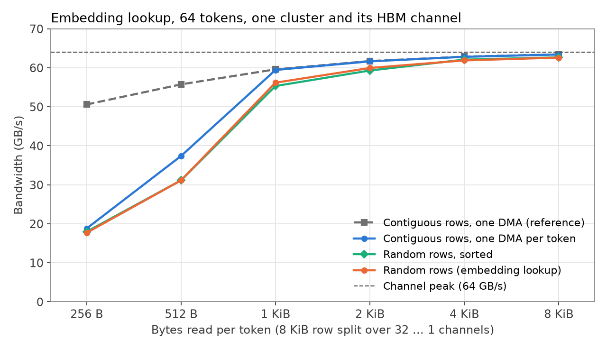
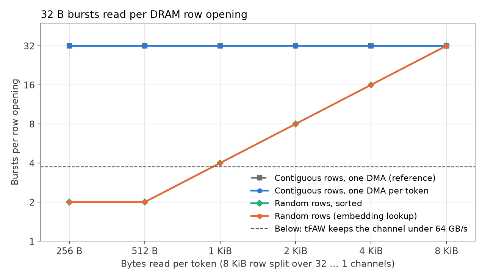

# Local HBM bandwidth: embedding lookup

What happens when the rows to read come from the data? After tokenization, an
LLM reads one row of its embedding table per token, `x[i] = E[id[i]]`: which
rows, and in which order, depends on the text. The DM core of cluster 0
reads the rows of 64 tokens from a table in HBM 0 into TCDM, one DMA per
token, with all of them in flight.

> **Simulator setup.** As in the
> [sequential sweep](../app_dram_bandwidth_sequential/README.md): DRAMSys with
> the repository's HBM4 timings, asynchronous wide-port arbiter, iDMA writing
> read data to TCDM in 512 B chunks. One cluster reads its own channel; no
> compute, no other clusters.

## What is measured

A **piece** is what one HBM channel holds of an 8 KiB row (Llama-3-8B: hidden
4096 in BF16): the whole row when the table is split across channels by rows,
256 B to 4 KiB when it is split by columns over 32 to 2 channels. For every
piece size, four orders:

| Order | Rows | DMAs | What it isolates |
| --- | --- | --- | --- |
| `block` | contiguous | one for all 64 rows | the DRAM alone (reference) |
| `contiguous` | contiguous | one per token | the cost of one DMA per token |
| `sorted` | random, ascending | one per token | the lookup after sorting the IDs |
| `random` | random, in token order | one per token | the real lookup |

**bandwidth = 64 × piece / elapsed time**, from the first DMA to the end of the
last one. 21 samples per point, each after an untimed pseudo-random wait of
0–3.9 µs that keeps them from locking onto the DRAM refresh
([why](../app_dram_bandwidth_sequential/README.md#why-small-copies-are-noisy)).

The table fills 48 MiB of channel 0 (6144 rows of 8 KiB, 196608 of 256 B); the
real one, 128256 × 8 KiB ≈ 1 GB, does not fit in a channel, but 64 random rows
out of thousands are just as scattered. The random IDs come from a fixed
xorshift generator, and `summarize.py` regenerates them to check every sample.
At setup every row a sample will read is tagged with its address, so reading a
wrong row is caught. Code: [main.cpp](main.cpp).

## Build and run

From the SDK root, after the [SoftHier setup](../../../README.md); the
simulation takes about 10 minutes. The first lines give DRAMSys the
repository's configs without its prebuilt library, as in the
[sequential guide](../app_dram_bandwidth_sequential/README.md#build-and-run).

```bash
set -e
mkdir -p .local-artifacts/dramsys
cp -r add_dramsyslib_patches/dramsys_configs .local-artifacts/dramsys/
export DRAMSYS_PATH="$PWD/.local-artifacts/dramsys"
APP_DIR="$PWD/pulp/pulp/chips/softhier/common/sw/app_dram_bandwidth_embeddings"
make sh-hw TOPOLOGY=2d_mesh
make sh-sw TOPOLOGY=2d_mesh app="$APP_DIR"
mkdir -p .local-artifacts/dram-bandwidth-embeddings
RUN_DIR="$(mktemp -d "$PWD/.local-artifacts/dram-bandwidth-embeddings/run.XXXXXX")"
cp sw_build/softhier.elf "$RUN_DIR/softhier.elf"
make sh-run TOPOLOGY=2d_mesh SH_TRACE_ARGS= RUN_ARGS="--work-dir=$RUN_DIR" \
    > "$RUN_DIR/simulation.log" 2>&1
python3 "$APP_DIR/summarize.py" "$RUN_DIR/simulation.log" > "$RUN_DIR/bandwidth.csv"
python3 "$APP_DIR/query_dram.py" "$RUN_DIR/simulation.log" "$RUN_DIR" > "$RUN_DIR/dram.csv"
rm -f "$RUN_DIR"/*.tdb
pulp/.venv/bin/python "$APP_DIR/plot.py" "$RUN_DIR"
```

A good run ends with `[dram-embeddings] errors=0` and
`SoftHier DRAM embeddings: OK`.
`query_dram.py` counts, for every sample, the DRAM reads, row openings and banks
in the channel 0 database.

## Results

One run on 2026-11-27; all 504 samples passed the data check. The numbers are
in [bandwidth.csv](assets/data/bandwidth.csv) and
[dram.csv](assets/data/dram.csv).



**A whole row per token costs almost nothing in random order:** 62.6 GB/s at
8 KiB, 1% below contiguous rows. The order starts to matter below 1 KiB:

| Piece | `block` | `contiguous` | `sorted` | `random` |
| ---: | ---: | ---: | ---: | ---: |
| 256 B | 50.6 GB/s | 18.8 GB/s | 17.9 GB/s | 17.7 GB/s |
| 512 B | 55.7 GB/s | 37.4 GB/s | 31.1 GB/s | 31.1 GB/s |
| 1 KiB | 59.6 GB/s | 59.4 GB/s | 55.3 GB/s | 56.2 GB/s |
| 2 KiB | 61.7 GB/s | 61.6 GB/s | 59.3 GB/s | 59.9 GB/s |
| 4 KiB | 62.8 GB/s | 62.8 GB/s | 62.1 GB/s | 61.9 GB/s |
| 8 KiB | 63.4 GB/s | 63.4 GB/s | 62.7 GB/s | 62.6 GB/s |

Two limits add up, one per step of the table.

**One DMA per token** (`block` → `contiguous`). Issuing a DMA per token costs
about 13.6 ns, close to the 13 instructions of the loop that does it: load the
ID, compute the two addresses, issue the three DMA instructions and loop. So 256 B pieces stop at 18.8 GB/s
and 512 B at 37.4 GB/s even with contiguous rows. From 1 KiB the DRAM needs
more than 13.6 ns per piece and the issue cost disappears.

**Random rows** (`contiguous` → `random`). A DRAM row holds 1 KiB spread over
8 KiB of addresses (64 B every 512 B), so a random 256–512 B piece opens 4–8
rows and reads 64 B, two 32 B bursts, from each. A pseudo-channel opens at most
four rows every 15 ns (`tFAW`): 2 × 4 × 64 B / 15 ns = 34 GB/s for the channel,
and random 512 B pieces reach 31.1 GB/s. From 1 KiB each opening gives 128 B or
more, and the limit rises above the channel's 64 GB/s.



Contiguous rows read all 32 bursts of every row they open; random rows read 2
up to 512 B, then twice as many per doubling. Below the dashed line `tFAW`
keeps the channel under 64 GB/s.

**Sorting the IDs does not help:** 64 random rows out of thousands share no
DRAM row even in ascending order, so `sorted` and `random` stay within 2%.

**For the compiler.**

- Split by rows, each channel holding whole rows, the lookup is as fast as a
  contiguous read; but which channel serves a token depends on its ID, so the
  load on channels and clusters is unbalanced.
- Split by columns, the load is balanced, but a channel needs at least 1 KiB of
  each row (an 8 KiB row over at most 8 channels) to escape `tFAW`, and below
  1 KiB one DMA per token costs more than the DRAM.
- The lookup itself is small: 8 KiB per token, against about 16 GB of weights
  read per generated token. It matters as the case where the addresses are
  known only at runtime.

## Regenerate the figures

```bash
APP_DIR="$PWD/pulp/pulp/chips/softhier/common/sw/app_dram_bandwidth_embeddings"
pulp/.venv/bin/python "$APP_DIR/plot.py"
```

`plot.py` reads `assets/data/` and writes both charts into `assets/figures/`;
`row_openings.png` needs `dram.csv`. For a new run, `plot.py "$RUN_DIR"` draws
them next to its CSVs (`--output-dir` changes this). `assets/data/memspec.json`
is the DRAM configuration of the run.
