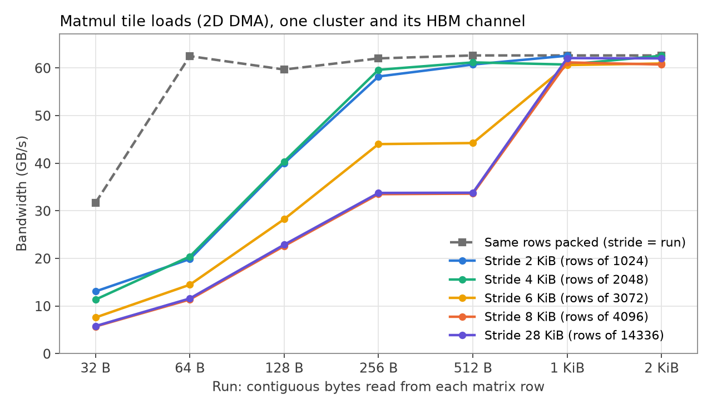
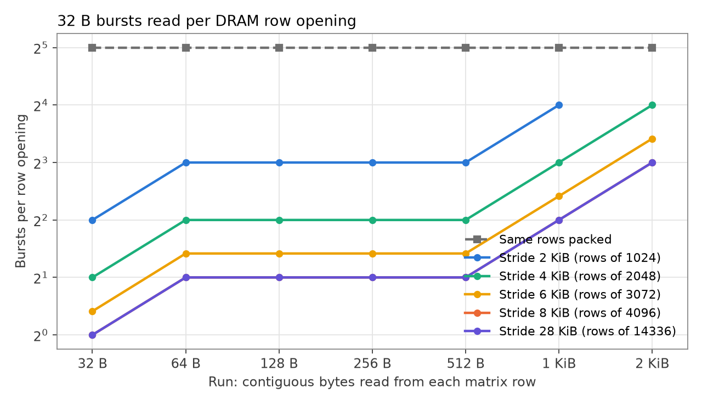
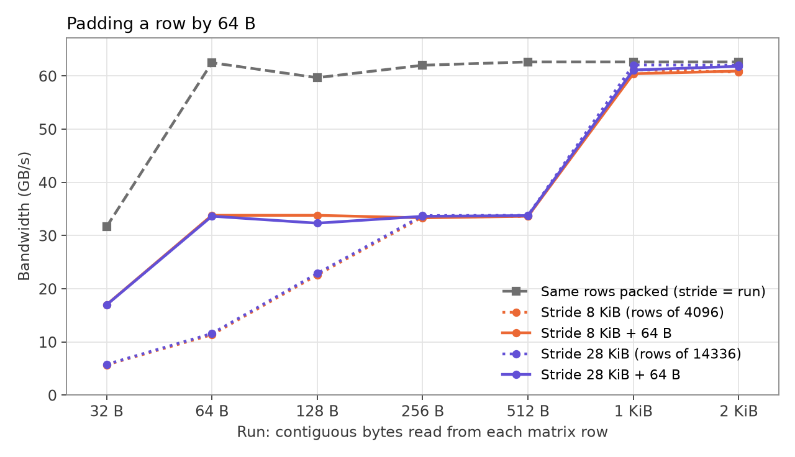
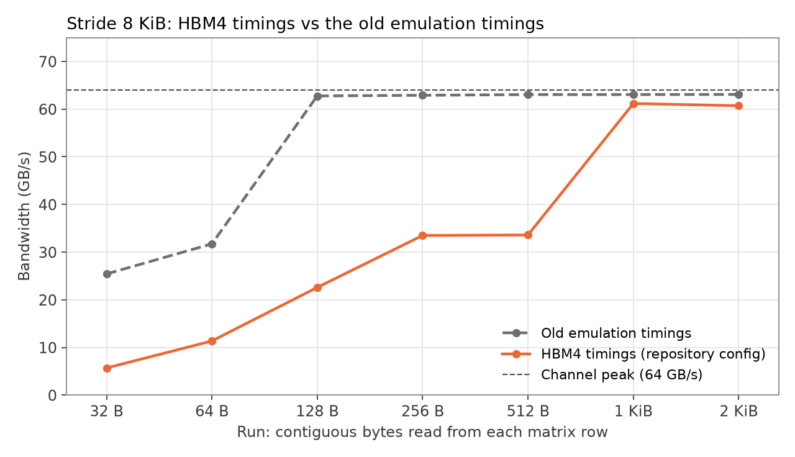

# Local HBM bandwidth: matmul tile loads

How much does the layout of a matrix cost? A tiled matmul loads each tile of
its operands with a 2D DMA: from every matrix row it reads `run` contiguous
bytes (the tile width), then jumps to the next row, `stride` bytes further (the
row length). The DM core of cluster 0 loads such tiles from HBM 0 into TCDM,
for runs of 32 B to 2 KiB and the row lengths of Llama-3-8B. There is no
compute: only the loads.

> **Simulator setup.** As in the
> [sequential sweep](../app_dram_bandwidth_sequential/README.md): DRAMSys with
> the repository's HBM4 timings, asynchronous wide-port arbiter, iDMA writing
> read data to TCDM in 512 B chunks. One cluster reads its own channel.

## What is measured

Each sample issues eight 2D copies of 32 KiB back to back and waits once, like
the [pipelined sweep](../app_dram_bandwidth_pipelined/README.md).
**bandwidth = 8 × 32 KiB / elapsed time.** The copies walk down a column of
tiles, then move to the next column. Five samples per point, each after an
untimed pseudo-random wait of 0–3.9 µs that keeps them from locking onto the
DRAM refresh
([why](../app_dram_bandwidth_sequential/README.md#why-small-copies-are-noisy)).

| Stride | Rows of | In Llama-3-8B (BF16) |
| --- | --- | --- |
| 2 KiB | 1024 values | `k_proj` and `v_proj` weights; one KV-cache token |
| 8 KiB | 4096 | activations into q/k/v/o and gate/up; `q_proj`, `o_proj`, `down_proj` weights |
| 28 KiB | 14336 | `gate_proj` and `up_proj` weights; activations into `down_proj` |
| 4, 6 KiB | 2048, 3072 | the same matrices in smaller models (Llama-3.2-1B, 3B) |
| +64 B | | the 8 and 28 KiB rows padded by 64 B |
| packed | | stride = run: the same bytes contiguous, as in a blocked layout |

The weights are stored as RedMulE reads them, W in `Z = X·W`, one row per
input (the GEMV in [app_example](../app_example/gemv.tpp) reads them the same
way), so their rows are as long as the outputs. A tile of W then reads runs of
`tile outputs × 2 B`, a tile of the activations `tile inputs × 2 B`. One extra
point, 1792 B runs at stride 28 KiB, is the part of the `down_proj` activations
one of 16 clusters reads (896 of 14336 values). After timing, the app checks
the last copy against the pattern written at setup. Code: [main.cpp](main.cpp).

## Build and run

From the SDK root, after the [SoftHier setup](../../../README.md); the
simulation takes about 15 minutes. The first lines give DRAMSys the
repository's configs without its prebuilt library, as in the
[sequential guide](../app_dram_bandwidth_sequential/README.md#build-and-run).

```bash
set -e
mkdir -p .local-artifacts/dramsys
cp -r add_dramsyslib_patches/dramsys_configs .local-artifacts/dramsys/
export DRAMSYS_PATH="$PWD/.local-artifacts/dramsys"
APP_DIR="$PWD/pulp/pulp/chips/softhier/common/sw/app_dram_bandwidth_matmul"
make sh-hw TOPOLOGY=2d_mesh
make sh-sw TOPOLOGY=2d_mesh app="$APP_DIR"
mkdir -p .local-artifacts/dram-bandwidth-matmul
RUN_DIR="$(mktemp -d "$PWD/.local-artifacts/dram-bandwidth-matmul/run.XXXXXX")"
cp sw_build/softhier.elf "$RUN_DIR/softhier.elf"
make sh-run TOPOLOGY=2d_mesh SH_TRACE_ARGS= RUN_ARGS="--work-dir=$RUN_DIR" \
    > "$RUN_DIR/simulation.log" 2>&1
python3 "$APP_DIR/summarize.py" "$RUN_DIR/simulation.log" > "$RUN_DIR/bandwidth.csv"
python3 "$APP_DIR/query_dram.py" "$RUN_DIR/simulation.log" "$RUN_DIR" > "$RUN_DIR/dram.csv"
rm -f "$RUN_DIR"/*.tdb
pulp/.venv/bin/python "$APP_DIR/plot.py" "$RUN_DIR"
```

A good run ends with `[dram-matmul] errors=0` and
`SoftHier matmul DRAM bandwidth: OK`. `query_dram.py` counts, for every sample,
the DRAM reads, row openings and banks in the channel 0 database.

## Results

One run on 2026-11-27; all 280 samples passed the data check. The numbers are
in [assets/data/hbm4/](assets/data/hbm4/), with the memspec of the run.



The grey dashed line reads the same bytes packed; the others are the
row-major layout, one line per stride.

| Run | Packed | Stride 2 KiB | Stride 8 KiB | 8 KiB + 64 B |
| ---: | ---: | ---: | ---: | ---: |
| 32 B | 31.6 GB/s | 13.0 GB/s | 5.7 GB/s | 17.0 GB/s |
| 64 B | 62.5 GB/s | 19.8 GB/s | 11.3 GB/s | 33.8 GB/s |
| 128 B | 59.7 GB/s | 40.0 GB/s | 22.6 GB/s | 33.8 GB/s |
| 256 B | 62.0 GB/s | 58.2 GB/s | 33.5 GB/s | 33.3 GB/s |
| 512 B | 62.6 GB/s | 60.7 GB/s | 33.6 GB/s | 33.6 GB/s |
| 1 KiB | 62.6 GB/s | 62.6 GB/s | 61.2 GB/s | 60.4 GB/s |
| 2 KiB | 62.6 GB/s | 62.6 GB/s | 60.7 GB/s | 60.9 GB/s |

**Short runs at long strides lose most of the channel.** At stride 8 KiB, and
the same at 28 KiB, runs up to 512 B get at most 34 GB/s, about half the
channel, and 32 B runs 5.7 GB/s. From 1 KiB they are back within 3% of packed
rows. Stride 2 KiB is gentler: from 256 B it is within about 6%. (Packed 32 B
runs stop at 32 GB/s for another reason: the iDMA sends one 32 B line per
cycle. Packed 128 B rows are 5% low because three of their five samples
started during a DRAM refresh; a few other points carry the same small error.)

### Why: where the addresses land

The DRAMSys address mapping (`am_hbm4_emu_16Gb_pc_brc.json`) splits an
address like this:

| Address bits | Select |
| --- | --- |
| 0–5 | 64 B in one row of one bank (two 32 B bursts) |
| 6 | the pseudo-channel |
| 7–8, 13 | the bank group |
| 9–12 | more columns of the same row |
| 14 and up | the bank (16–17) and the row |

So a DRAM row holds 1 KiB, spread over 8 KiB of addresses: 64 B every 512 B.
Contiguous data use every row they open in full; a short run touches a little
of several rows. Three limits follow, and each matches the measurements.

1. **One pseudo-channel.** With a stride multiple of 128 B, bit 6 never
   changes between rows, so runs under 128 B use half the channel.
2. **Same banks, new rows.** At stride 8 KiB, consecutive rows differ only from
   bit 13 up: the reads keep going back to the same 8 banks with a new row
   each time, and a bank can open a row only every 45 ns (`tRC`). That gives
   8 × 32 B / 45 ns = **5.7 GB/s** for 32 B runs, 11.4 GB/s for 64 B, and
   22.8 GB/s for 128 B, which reach both pseudo-channels and 16 banks.
3. **Four row openings every 15 ns** (`tFAW`) per pseudo-channel. From 256 B
   the runs spread over enough banks, but each opening still gives only 64 B:
   2 × 4 × 64 B / 15 ns = **34.1 GB/s**. From 1 KiB an opening gives 128 B or
   more, and the limit rises above the channel's 64 GB/s.



Packed rows read all 32 bursts of every row they open. At stride 8 or 28 KiB a
row opening gives 1 burst at 32 B and 2 up to 512 B; below about 4 bursts per
opening, `tFAW` keeps the channel under 64 GB/s.

### Padding a row by 64 B



64 B more per row moves each row to the other pseudo-channel and to other
banks, so it removes limits 1 and 2: 32 B runs go from 5.7 to 17.0 GB/s, 64
and 128 B runs to 33.8 GB/s. **It cannot remove limit 3**: 2 × 4 × 32 B / 15 ns
= 17.1 GB/s and 2 × 4 × 64 B / 15 ns = 34.1 GB/s are exactly the padded values.

### HBM4 timings vs the old ones



Stride 8 KiB with the old emulation timings (grey,
[assets/data/ccds4/](assets/data/ccds4/)) and the HBM4 ones (orange). The old
timings had `tRC` = 10 ns and `tFAW` = 2 ns, so only limit 1 showed: 64 B runs
at 31.7 GB/s, half the channel, and from 128 B the full channel. Limits 2 and 3
come with the real row timings.

### For the compiler

- **Tiles at least 512–1024 values wide** (runs of 1–2 KiB) keep the row-major
  layout near the peak at any stride.
- **Narrow tiles:** padding the rows by 64 B helps runs up to 128 B; beyond,
  `tFAW` still caps them at 34 GB/s.
- **The weights are static:** stored in blocks offline, a tile is contiguous
  and reads at the packed rate.
- **Example:** the GEMV of `app_example` (`C::M = 256`) reads 512 B runs. On
  `q_proj` (stride 8 KiB) that is the 34 GB/s point, against 63 GB/s with the
  weights in blocks; on `k_proj`/`v_proj` (stride 2 KiB), 60.7 GB/s.

**What this sweep leaves out:** compute that would overlap the loads, the
writes of the result, other clusters on the NoC and on the channel. For a
GEMV, which is limited by memory, the load bandwidth is close to the kernel's
speed; in a GEMM the compute hides part of it.

## Regenerate the figures

```bash
APP_DIR="$PWD/pulp/pulp/chips/softhier/common/sw/app_dram_bandwidth_matmul"
pulp/.venv/bin/python "$APP_DIR/plot.py"
```

`plot.py` reads `assets/data/hbm4/` and writes every chart into
`assets/figures/`; `row_openings.png` needs `dram.csv`, and `timings.png` the
old-timings run in `assets/data/ccds4/`. For a new run, `plot.py "$RUN_DIR"`
draws the charts next to its CSVs (`--output-dir` changes this).
