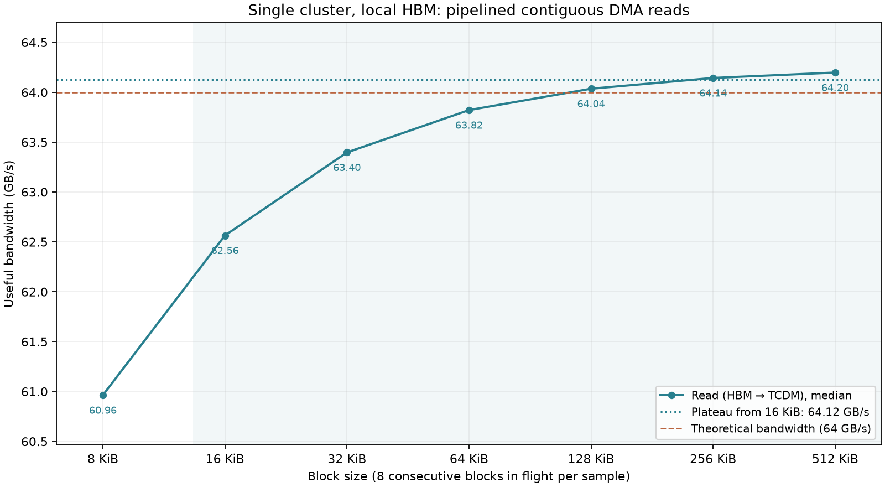
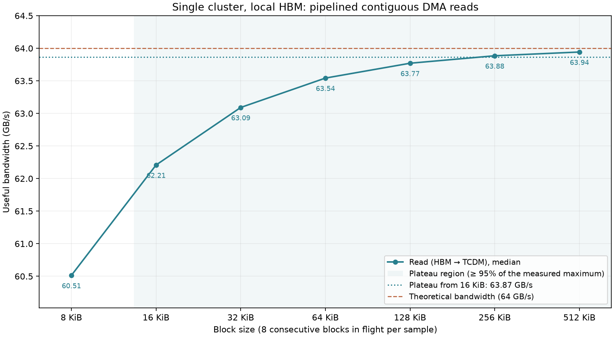

# Local HBM bandwidth: pipelined contiguous reads

What is the highest read bandwidth one cluster sustains from its local HBM
channel? The DM core of cluster 0 reads contiguous blocks from HBM 0 into TCDM,
with block sizes doubling from **64 B to 512 KiB**: 14 sizes, three samples
each, 42 measurements.

## What differs from the streaming sweep

Each sample issues eight consecutive blocks back to back and waits once, so
the DMA always has the next copy queued. The
[streaming app](../app_dram_bandwidth_streaming/README.md) waits after every
copy, which leaves the DMA idle for the latency of each one. Every sample reads
its own consecutive window, starting at 4 MiB in channel 0, so no block is read
twice.

## What is timed

**Bandwidth = 8 × block size / elapsed time**, from issuing the first copy to
the end of the last one, including clock reads. Setup, checks and printing are
untimed. After timing, the buffer must hold the last block, identified by an
address tag in its first word. `summarize.py` rejects partial runs, errors,
wrong offsets and overlapping windows.

## Build and run

From the **SDK root**, after the [SoftHier setup](../../../README.md). No
`sh-data` is needed; the simulation takes about 7 minutes.

```bash
set -e
APP_DIR="$PWD/pulp/pulp/chips/softhier/common/sw/app_dram_bandwidth_pipelined"
make sh-hw TOPOLOGY=2d_mesh
make sh-sw TOPOLOGY=2d_mesh app="$APP_DIR"
mkdir -p .local-artifacts/dram-bandwidth-pipelined
RUN_DIR="$(mktemp -d "$PWD/.local-artifacts/dram-bandwidth-pipelined/run.XXXXXX")"
cp sw_build/softhier.elf "$RUN_DIR/softhier.elf"
make sh-run TOPOLOGY=2d_mesh SH_TRACE_ARGS= RUN_ARGS="--work-dir=$RUN_DIR" \
    > "$RUN_DIR/simulation.log" 2>&1
python3 "$APP_DIR/summarize.py" "$RUN_DIR/simulation.log" \
    --report "$RUN_DIR/report.md" > "$RUN_DIR/bandwidth.csv"
pulp/.venv/bin/python "$APP_DIR/plot.py" "$RUN_DIR/bandwidth.csv" \
    --output "$RUN_DIR/bandwidth.png"
```

A valid run ends with `[dram-pipelined] errors=0` and
`SoftHier pipelined DRAM bandwidth: OK`. With `DatabaseRecording: true` in
DRAMSys, `query_dram.py "$RUN_DIR/simulation.log" "$RUN_DIR" > "$RUN_DIR/dram.csv"`
attributes the DRAM traffic to each sample; delete the `.tdb` files afterwards.
Without `--output`, `plot.py` writes into this app's `assets/`.

## Results



Measured on 2026-11-20 with the asynchronous wide-port arbiter and the shared
DRAMSys configuration. All 42 samples passed the data check, and for every
sample the DRAM read exactly the payload bytes.

| Plateau from | Plateau level | 4 KiB | 64 KiB | 512 KiB |
| ---: | ---: | ---: | ---: | ---: |
| 16 KiB | 64.12 GB/s | 58.00 GB/s | 63.82 GB/s | 64.20 GB/s |

The plateau onset uses the warm sweep's criterion: the last three medians span
at most 3%, and from the onset onward every median is at least 95% of the
maximum. The plateau level is the mean of the last three sizes. The figure
starts at 8 KiB; all values are in [assets/bandwidth.csv](assets/bandwidth.csv).

Keeping eight copies in flight matters for small blocks: a 4 KiB read reaches
58.00 GB/s here against 37.62 GB/s in the streaming sweep with the same
configuration, which pays the full latency of every copy. At 512 KiB the two
converge (64.20 vs 63.90 GB/s). With `CCDS = 4` the gap is the same: 57.39 vs
35.05 GB/s at 4 KiB, 63.94 vs 63.61 GB/s at 512 KiB.

## Why the plateau exceeds 64 GB/s

64 GB/s is the nominal bus bandwidth of the configured channel: two
pseudo-channels of 32 bits at 8 Gbit/s per pin. The sweep was rerun with
`CCDS = 4` on a copy of the DRAMSys configuration:

| | `CCDS = 2` (shared configuration, results above) | `CCDS = 4` |
| --- | ---: | ---: |
| Plateau level | 64.12 GB/s | 63.87 GB/s |
| 512 KiB | 64.20 GB/s | 63.94 GB/s |
| Overlapping bursts per pseudo-channel, 512 KiB sample | 5355 of 65536 | 0 |
| Bus occupancy per pseudo-channel, 512 KiB sample | 100.4% | 100.0% |

The HBM4 emulation is configured as HBM2, which DRAMSys supports, with 8-beat
bursts (`tBURST` = 4 cycles = 1 ns) but a bank-group-to-bank-group column
spacing `CCDS` of 2 cycles, the HBM2 value for 4-beat bursts (DRAMSys's own
`HBM2.json` uses BL4 with `CCDS = 2`). `CheckerHBM2.cpp` spaces consecutive
reads on a pseudo-channel only by `tCCDL` (same bank group) and `tCCDS`
(different bank group); `tBURST` does not enter that check, which assumes
`tCCDS >= tBURST`. With `CCDS = 2`, some bursts start 0.5 ns after the previous
one, always in a different bank group, and share the bus with it.

With `CCDS = 4` every overlap disappears: each pseudo-channel carries one burst
per nanosecond and the bus delivers exactly 64.0 GB/s, so the remaining 0.1%
below nominal is the fixed cost at the start and end of each sample. Row
changes are hidden by bank parallelism, and refreshes are postponed out of these
short samples (`RefreshMaxPostponed` allows 128, about 160 µs); a longer
continuous stream would pay for them.



The `CCDS = 4` sweep: plateau from 16 KiB at 63.87 GB/s. Values are in
[assets/bandwidth_ccds4.csv](assets/bandwidth_ccds4.csv). To reproduce it, copy
`dramsys_configs/` from the directory `DRAMSYS_PATH` points to, set `"CCDS": 4`
in `memspec/HBM4-emulation-4000.json`, and point `DRAMSYS_PATH` at the copy.
