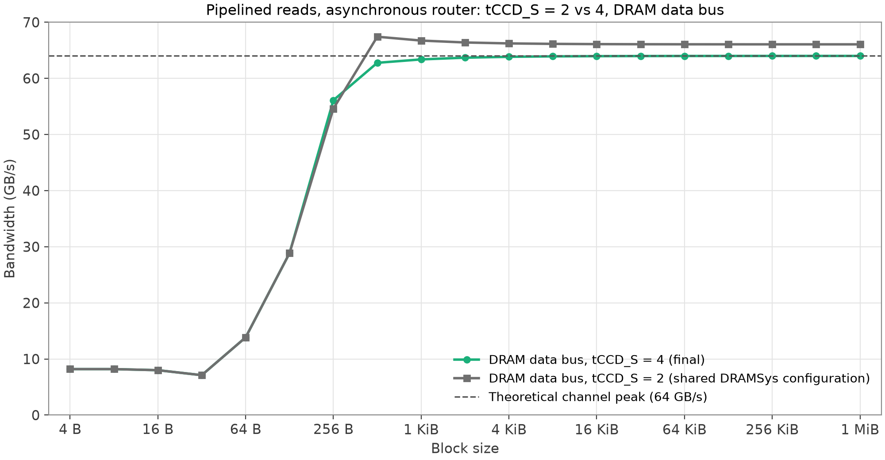

# Local HBM bandwidth: pipelined contiguous reads

How fast can one cluster read from its local HBM channel when it keeps the DMA
busy? The DM core of cluster 0 copies contiguous blocks from HBM 0 into TCDM,
from **4 B to 1 MiB** (doubling each time: 19 sizes, three samples each). It is
the [sequential sweep](../app_dram_bandwidth_sequential/README.md) with eight
copies in flight instead of one.

> **Simulator setup.** Asynchronous wide-port arbiter, iDMA writing read data
> to TCDM in 512 B chunks
> ([why](../app_dram_bandwidth_sequential/README.md#simulator-fixes)), and
> DRAMSys with `CCDS = 4`. The shared DRAMSys configuration has `CCDS = 2`,
> which lets bursts overlap on the data bus and go past 64 GB/s
> ([why](#why-ccds--2-exceeded-64-gbs)).

## What is measured

Each sample issues eight consecutive copies back to back and waits once, so the
DMA always has the next one queued; the sequential app waits after every copy.
The core times from the first request to the end of the last copy:

**bandwidth = 8 × block size / elapsed time**

Every sample reads its own window, starting at 4 MiB in channel 0 and aligned
to a 32 B burst, so nothing is read twice. After timing, the app checks that
TCDM holds the last block (an address tag in its first word), and
`summarize.py` rejects partial runs, errors, wrong offsets and overlapping
windows. Blocks up to 512 KiB land at TCDM offset `0x40000`; a 1 MiB block
fills the whole TCDM.

## Build and run

From the SDK root, after the [SoftHier setup](../../../README.md); the
simulation takes about 15 minutes. For `CCDS = 4`, copy `dramsys_configs/` from
where `DRAMSYS_PATH` points, set `"CCDS": 4` in
`memspec/HBM4-emulation-4000.json`, and point `DRAMSYS_PATH` at the copy.

```bash
set -e
APP_DIR="$PWD/pulp/pulp/chips/softhier/common/sw/app_dram_bandwidth_pipelined"
make sh-hw TOPOLOGY=2d_mesh
make sh-sw TOPOLOGY=2d_mesh app="$APP_DIR"
mkdir -p .local-artifacts/dram-bandwidth-pipelined
RUN_DIR="$(mktemp -d "$PWD/.local-artifacts/dram-bandwidth-pipelined/run.XXXXXX")"
cp sw_build/softhier.elf "$RUN_DIR/softhier.elf"
make sh-run TOPOLOGY=2d_mesh SH_TRACE_ARGS= RUN_ARGS="--work-dir=$RUN_DIR" \
    > "$RUN_DIR/simulation.log" 2>&1
python3 "$APP_DIR/summarize.py" "$RUN_DIR/simulation.log" \
    --report "$RUN_DIR/report.md" > "$RUN_DIR/bandwidth.csv"
python3 "$APP_DIR/query_dram.py" "$RUN_DIR/simulation.log" "$RUN_DIR" \
    > "$RUN_DIR/dram.csv"
rm -f "$RUN_DIR"/*.tdb
pulp/.venv/bin/python "$APP_DIR/plot.py" "$RUN_DIR"
```

A good run ends with `[dram-pipelined] errors=0` and
`SoftHier pipelined DRAM bandwidth: OK`. `query_dram.py` reads the DRAMSys
databases (`DatabaseRecording: true`, on by default); they take several GB and
can go once `dram.csv` exists. Don't start two simulations at the same moment
from one SDK: both rewrite the NoC topology file.

To keep single bursts, extract them from the channel 0 database before
deleting it:

```bash
python3 "$APP_DIR/query_trace.py" "$RUN_DIR/simulation.log" "$RUN_DIR" \
    --size 512 --tdb "$RUN_DIR/trace.tdb"
python3 "$APP_DIR/query_trace.py" "$RUN_DIR/simulation.log" "$RUN_DIR" \
    --spacing > "$RUN_DIR/spacing.csv"
```

The first cuts the 512 B sample out of the DRAMSys trace, in its own format
(without `--tdb` it prints one CSV row per request instead). The second
counts, for every sample, the gaps between consecutive bursts and whether they
came from the same bank group (`tCCD_L`) or not (`tCCD_S`).

## Results

One run on 2026-11-26; all 57 samples passed the data check. Every chart has
the block size on the horizontal axis, 4 B to 1 MiB. The numbers are in
[bandwidth.csv](assets/data/bandwidth.csv) and [dram.csv](assets/data/dram.csv).

### How fast can one cluster read?


Orange is the bandwidth the core measures; the light band around it is the
min–max of the three samples. The dashed line is the channel's peak, 64 GB/s,
and the grey area is the plateau, where every point is within 5% of the best.
The two black curves are the models explained
[below](#how-far-the-curve-is-from-a-simple-model).

**One cluster saturates its HBM channel.** Bandwidth climbs fast, flattens from
8 KiB and reaches **63.98 GB/s at 1 MiB, 99.97% of the peak**.

| 1 KiB | 4 KiB | 16 KiB | 64 KiB | 1 MiB |
| ---: | ---: | ---: | ---: | ---: |
| 47.91 GB/s | 59.04 GB/s | 62.68 GB/s | 63.67 GB/s | 63.98 GB/s |

### How far the curve is from a simple model

We start from the latency-bandwidth (alpha-beta) model of the
[sequential sweep](../app_dram_bandwidth_sequential/README.md#how-far-the-curve-is-from-a-simple-model):
every copy pays a fixed cost `alpha`, then moves its `N` bytes at bandwidth
`1/beta`.

$$
T(N)=\alpha+\beta N
$$

Fitted on the 64–256 KiB points (time per copy = sample time / 8), it gives
**`alpha = 5.375 ns` per copy and `1/beta = 64.000 GB/s`**, the channel's peak.
**From 512 B to 1 MiB it predicts every time to the picosecond**, even at
512 KiB and 1 MiB, which were not in the fit.

`alpha` is the on-chip latency. In every sample from 512 B up, 41.75 ns pass
outside the DRAM's busy window (the first request travelling to the DRAM, the
last data travelling back), and the window is 1.25 ns longer than the bytes
alone. That is 43 ns per sample, 5.375 ns per copy, since the eight copies
share it. The sequential sweep pays 37.125 ns per copy, 6.9× more, and that is
where pipelining wins on small and medium blocks.

(Before the [iDMA fix](../app_dram_bandwidth_sequential/README.md#idma-read-data-in-chunks)
the time outside the window grew from 42 to 56.5 ns between 512 B and 4 KiB,
`alpha` was 7.375 ns, and the model needed a fixed cost that grew with the
block. The fix saves 16 ns per sample from 4 KiB, +2.9% at 4 KiB; up to 512 B
nothing changed.)

**Below 512 B we add a floor:**

$$
T(N)=\max\left(T_{\min},\ \alpha+\beta N\right)
$$

**`T_min = 9.875 ns` per copy (79 ns per sample).** Up to 256 B a sample takes
73–79 ns whatever the size: the eight requests reach the DRAM about 4.5 ns
apart, so the time depends on how fast they arrive, not on the bytes. `T_min`
is the slowest of these samples.

| Block | Measured | Alpha-beta model | With the floor |
| ---: | ---: | ---: | ---: |
| 4 B | 0.44 GB/s | 0.74 GB/s (−40%) | 0.41 GB/s (+8%) |
| 32 B | 3.24 GB/s | 5.45 GB/s (−41%) | 3.24 GB/s (0%) |
| 64 B | 6.48 GB/s | 10.04 GB/s (−35%) | 6.48 GB/s (0%) |
| 256 B | 25.92 GB/s | 27.31 GB/s (−5%) | 25.92 GB/s (0%) |
| 512 B | 38.28 GB/s | 38.28 GB/s (0%) | 38.28 GB/s (0%) |

The percentages are measured vs model. **With the floor the model is exact
from 32 B to 1 MiB.** Below 32 B it is up to 8% pessimistic, because smaller
requests reach the DRAM slightly closer together.

### One copy at a time vs eight in flight


Blue is the [sequential sweep](../app_dram_bandwidth_sequential/README.md),
which waits for each copy before starting the next; orange is this one, with
eight in flight.

**Both reach 64 GB/s, but pipelining gets there much sooner.** The gain comes
from waiting less, not from more bandwidth: 3.7× at 256 B, 1.4× at 4 KiB, and
under 4% from 64 KiB, where a single big copy already keeps the DRAM busy.

| Block | Sequential | Pipelined | Gain |
| ---: | ---: | ---: | ---: |
| 256 B | 7.04 GB/s | 25.92 GB/s | 3.7× |
| 4 KiB | 42.17 GB/s | 59.04 GB/s | 1.4× |
| 64 KiB | 61.62 GB/s | 63.67 GB/s | 1.03× |
| 1 MiB | 63.86 GB/s | 63.98 GB/s | 1.002× |

**For the compiler:** tiles below about 64 KiB need several DMA transfers in
flight (double buffering or more) to get close to the channel bandwidth.

### DRAM bandwidth vs what the cluster sees


Orange is what software gets: bytes copied over the time the core measures.
Green is how hard the DRAM works: bytes on its data bus over the time from its
first burst to its last. (Below 32 B the DRAM still moves whole 32 B bursts, so
green counts more bytes than the copy.)

**The DRAM is flat out already at 1 KiB** (63.4 GB/s) and reaches **64.00 GB/s
at 1 MiB, its physical limit**: one 32 B burst per nanosecond on each
pseudo-channel. The cluster catches up more slowly because of the 43 ns of
on-chip latency per sample [above](#how-far-the-curve-is-from-a-simple-model).


Each sample's time split in three: green, the DRAM bus moving data; yellow, the
bus idle between the first and the last burst; purple, the time outside the
DRAM window.

**From 512 B there is almost no yellow.** With eight copies queued, the DRAM
never waits for the next request (at most 1.6 ns per sample). Large blocks are
nearly all green; up to 256 B, purple is more than half, and the yellow is the
gaps between requests that arrive 4.5 ns apart. Compare it with the
[sequential breakdown](../app_dram_bandwidth_sequential/README.md#dram-bandwidth-vs-what-the-cluster-sees),
where a big yellow area shows the DRAM waiting between copies.

## Why `CCDS = 2` exceeded 64 GB/s

**No physical limit was broken: the simulator moved bytes that real wires
could not.** Each pseudo-channel has 32 data wires at 8 Gb/s, which carry one
32 B burst per nanosecond: 32 GB/s, 64 GB/s for the two. Going faster would
need two bursts on the same wires at once.

DRAMSys works like a timetable, not like a model of the wires. Before each read
it checks only the minimum gaps from earlier commands (`tCCD_L` within a bank
group, `tCCD_S` between bank groups, `tRCD` after opening a row), then
computes when the data *would* be on the bus. **By default DRAMSys does no
check at all to stop two bursts from sharing the data bus, something
impossible in hardware: it assumes the timing parameters are correct.**

Here one was not. `CCDS` (`tCCD_S`) was 2 cycles, 0.5 ns, for a burst that
lasts 4 cycles, 1 ns. That is the HBM2 value for 4-beat bursts, kept when the
emulation moved to 8-beat bursts. DRAMSys's HBM2 checker even has an `assert`
for 4-beat bursts, but the library is built in Release (`-DNDEBUG`), which
removes it. So a burst could start 0.5 ns after another one on the same wires.
The data still arrived intact (`errors=0`), because the simulator copies it
instead of sending it over wires.

With `CCDS = 4`, as long as one burst, nothing overlaps and the bus tops at
64.00 GB/s. **All results in this README use `CCDS = 4`.** (DRAMSys may
postpone up to 128 refreshes, so it mostly pushes them out of the samples; a
long stream would pay up to about 5% for them, `tRFC / tREFI` =
65 ns / 1.25 µs.)



DRAM bus bandwidth with the shared configuration (`CCDS = 2`, grey) and the
corrected one (`CCDS = 4`, green). **With `CCDS = 2` the bus goes past the
physical limit:** 67.4 GB/s at 512 B, 66.07 GB/s at 1 MiB. End to end it is
the same (66.04 vs 63.98 GB/s at 1 MiB, [ccds.png](assets/figures/ccds.png)):
3% above what any hardware could reach.

### What the overlap looks like

Two screenshots from DRAMSys's own viewer, the Trace Analyzer (v5.6.0), opened
on the 512 B samples kept in [assets/traces/](#where-the-data-comes-from). Both
show about 10 ns in the middle of a copy, when the requests are streaming in.

**How to read them.** Time goes left to right, and each vertical grid line is
one DRAM clock, 0.25 ns. Every row is something that can be busy, and every
hexagon is one thing keeping it busy:

- **REQ** is a 32 B read reaching the DRAM controller; **RESP** is its data
  going back (a thin mark, it takes no time).
- **Command Bus [C]** carries the read commands, one clock each. Command Bus [R]
  would carry row commands like ACT, but there are none in this window.
- **Data Bus [PC0]** and **[PC1]** are the wires of the two pseudo-channels.
  Each hexagon is one 32 B burst, 4 clocks (1 ns) long.

Watch the two data buses: on real wires, hexagons in the same row can touch
but never overlap.


**With `CCDS = 4`, that is exactly what happens.** The bursts sit end to end,
never on top of each other. Two read commands arrive every nanosecond, one per
pseudo-channel: 2 × 32 B per ns, 64 GB/s.


**With `CCDS = 2`, they pile up.** The bright magenta hexagons are bursts that
start half a nanosecond before the previous one has left the same wires: for
that half nanosecond, two bursts share 32 wires. It only happens between
different bank groups, where the gap is `tCCD_S`; inside one bank group
`tCCD_L` still keeps reads 1 ns apart.

### Why the `CCDS = 2` curve settles at 66.07 GB/s

The cluster sends one 512 B chunk (16 requests of 32 B) every 7.75 ns,
**66.07 GB/s**, faster than the channel. This rate is set by the cluster and
the network, and it is the same for 512 B and 1 MiB copies as long as the
DRAM keeps up.

| | 512 B copies | 1 MiB copies |
| --- | ---: | ---: |
| Requests, `CCDS = 4` | 66.07 GB/s | 64.00 GB/s |
| DRAM bus, `CCDS = 4` | 62.77 GB/s | 64.00 GB/s |
| Requests, `CCDS = 2` | 66.07 GB/s | 66.07 GB/s |
| DRAM bus, `CCDS = 2` | 67.42 GB/s | 66.07 GB/s |

With `CCDS = 4` the DRAM is the bottleneck: in a long copy its queue fills,
it accepts a new chunk only every 8 ns, and the bus stops at 64.00 GB/s. With
`CCDS = 2` it can go faster than the requests, so the queue never fills and
the bus just follows the request rate.
At 512 B it also catches up, with overlaps, on the requests that queued while
the first rows were opening, which gives the 67.4 GB/s. In a 1 MiB sample
19.1% of the gaps between bursts overlap. Counts per sample:
[spacing_ccds4.csv](assets/data/spacing_ccds4.csv),
[spacing_ccds2.csv](assets/data/spacing_ccds2.csv).

Before the iDMA fix, large copies sent their requests more slowly, 4 KiB every
63.75 ns (64.25 GB/s), so `CCDS = 2` went only 0.4% over the peak. Without the
fix the error was barely visible; with it, it is 3%.

### Where the data comes from

DRAMSys ([tukl-msd/DRAMSys](https://github.com/tukl-msd/DRAMSys), commit
`8e021ea`) writes every request and every DRAM command into one SQLite file per
channel, `DRAMSysRecordable0_hbm4-emu-example_example_ch0.tdb` for channel 0:
about 1 GB per run, too much for the repository. So `assets/traces/` keeps only
the 512 B sample of the screenshots, from both runs:
[trace_ccds4.tdb](assets/traces/trace_ccds4.tdb) and
[trace_ccds2.tdb](assets/traces/trace_ccds2.tdb), 128 requests with all their
phases and the configuration they were made with (`GeneralInfo.Memspec`).
The CSVs in `assets/data/` come from the full runs through the commands in
[Build and run](#build-and-run), at pulp commit `4e6fc6a`; rerunning them
gives the same files. The two traces are from the earlier runs at `0541a8a`,
before the iDMA fix: a 512 B copy fits in one chunk, and the new runs give the
same 128 requests with the same phases, only shifted in time.

To print the first bursts yourself:

```bash
python3 - <<'EOF'
import sqlite3
db = sqlite3.connect("assets/traces/trace_ccds2.tdb")
for begin, end, group in db.execute(
        "SELECT DataStrobeBegin, DataStrobeEnd, BankGroup FROM Phases "
        "WHERE PhaseName = 'RD' AND Rank = 0 ORDER BY DataStrobeBegin LIMIT 10"):
    print(begin, end, group)
EOF
```

Times are in picoseconds and `Rank` is the pseudo-channel. Every burst lasts
1000 ps; in `trace_ccds4.tdb` they start 1000 ps apart, in `trace_ccds2.tdb`
some only 500 ps. To open the files in the Trace Analyzer, build it from
DRAMSys `v5.6.0` (CMake option `DRAMSYS_BUILD_TRACE_ANALYZER`); later versions
use a newer format and cannot read them.

## Regenerate the figures

```bash
APP_DIR="$PWD/pulp/pulp/chips/softhier/common/sw/app_dram_bandwidth_pipelined"
pulp/.venv/bin/python "$APP_DIR/plot.py"
```

`plot.py` reads `assets/data/` and writes every chart into `assets/figures/`;
the sequential comparison also reads the sequential app's
`assets/data/bandwidth.csv` (`--sequential DIR` changes it). The two
`trace_analyzer_ccds*.png` are screenshots. For a new run, `plot.py "$RUN_DIR"`
draws the charts next to its CSVs (`--output-dir` changes this) and skips those
whose CSVs are missing. All DRAM sweep charts share
[dram_common/plot_sweep.py](../dram_common/plot_sweep.py).
