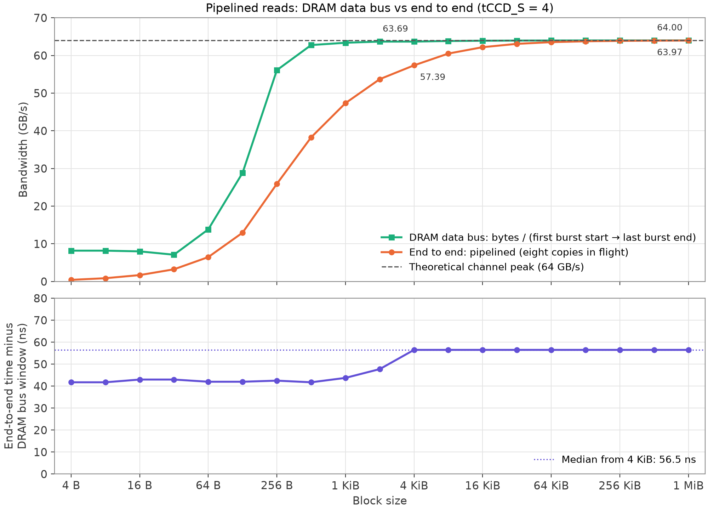
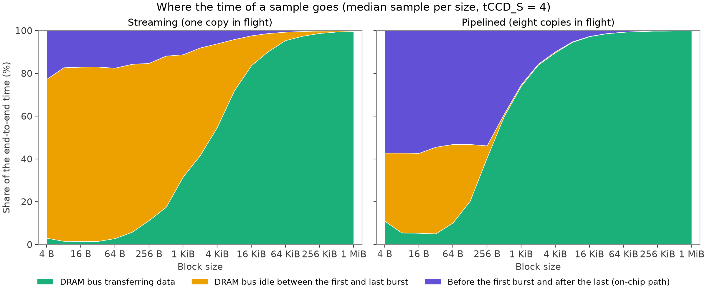
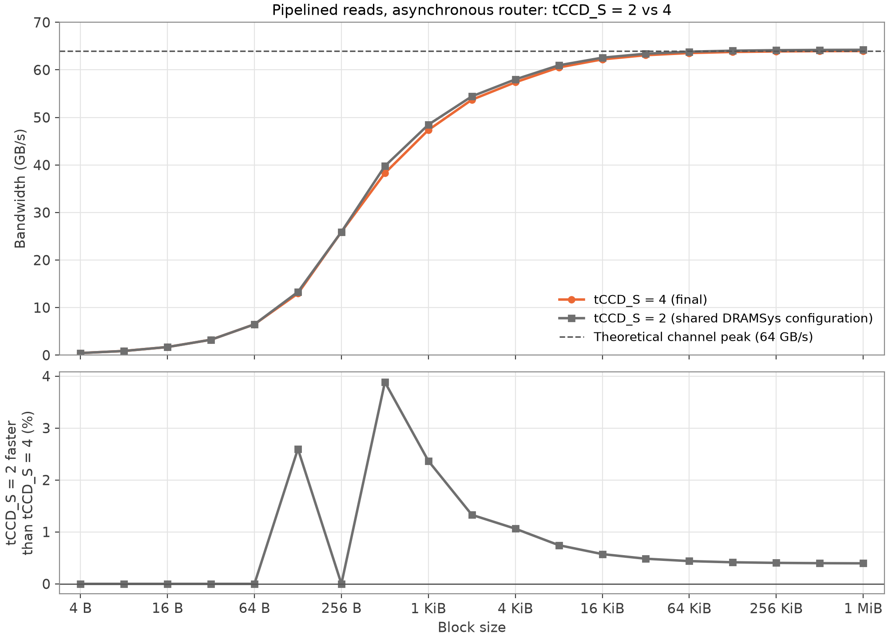

# Local HBM bandwidth: pipelined contiguous reads

What is the highest read bandwidth one cluster sustains from its local HBM
channel? The DM core of cluster 0 reads contiguous blocks from HBM 0 into TCDM,
with block sizes doubling from **4 B to 1 MiB**, the same range as the
[streaming sweep](../app_dram_bandwidth_streaming/README.md): 19 sizes, three
samples each, 57 measurements.

> **Simulator setup.** These results use the asynchronous wide-port arbiter and
> DRAMSys with `CCDS = 4` (see [Build and run](#build-and-run)). The shared
> DRAMSys configuration's `CCDS = 2` lets bursts overlap on the data bus and
> exceed 64 GB/s (see [Why `CCDS = 2` exceeded 64 GB/s](#why-ccds--2-exceeded-64-gbs)).

## What differs from the streaming sweep

Each sample issues eight consecutive blocks back to back and waits once, so
the DMA always has the next copy queued. The streaming app waits after every
copy, which leaves the DMA idle for the latency of each one. Every sample reads
its own consecutive window, starting at 4 MiB in channel 0, so no block is read
twice; windows start on a 32 B DRAM burst.

## What is timed

**Bandwidth = 8 × block size / elapsed time**, from issuing the first copy to
the end of the last one, including clock reads. Setup, checks and printing are
untimed. After timing, the buffer must hold the last block, identified by an
address tag in its first word. Blocks up to 512 KiB land at TCDM offset
`0x40000`; a 1 MiB block fills the whole TCDM (the app has no persistent `.l1`
data and does not use the runtime's barrier words). `summarize.py` rejects
partial runs, errors, wrong offsets and overlapping windows.

## Build and run

From the **SDK root**, after the [SoftHier setup](../../../README.md). No
`sh-data` is needed; the simulation takes about 15 minutes. The results below
use `CCDS = 4`: copy `dramsys_configs/` from the directory `DRAMSYS_PATH`
points to, set `"CCDS": 4` in `memspec/HBM4-emulation-4000.json`, and export
`DRAMSYS_PATH` pointing at the copy before `make sh-run`.

```bash
set -e
APP_DIR="$PWD/pulp/pulp/chips/softhier/common/sw/app_dram_bandwidth_pipelined"
make sh-hw TOPOLOGY=2d_mesh
make sh-sw TOPOLOGY=2d_mesh app="$APP_DIR"
mkdir -p .local-artifacts/dram-bandwidth-pipelined
RUN_DIR="$(mktemp -d "$PWD/.local-artifacts/dram-bandwidth-pipelined/run.XXXXXX")"
cp sw_build/softhier.elf "$RUN_DIR/softhier.elf"
make sh-run TOPOLOGY=2d_mesh SH_TRACE_ARGS= RUN_ARGS="--work-dir=$RUN_DIR" \
    > "$RUN_DIR/simulation.log" 2>&1
python3 "$APP_DIR/summarize.py" "$RUN_DIR/simulation.log" \
    --report "$RUN_DIR/report.md" > "$RUN_DIR/bandwidth.csv"
python3 "$APP_DIR/query_dram.py" "$RUN_DIR/simulation.log" "$RUN_DIR" \
    > "$RUN_DIR/dram.csv"
rm -f "$RUN_DIR"/*.tdb
pulp/.venv/bin/python "$APP_DIR/plot.py" "$RUN_DIR"
```

A valid run ends with `[dram-pipelined] errors=0` and
`SoftHier pipelined DRAM bandwidth: OK`. `query_dram.py` needs
`DatabaseRecording: true` in DRAMSys (the default in the shared configuration);
it attributes the DRAM traffic of every sample, and the `.tdb` databases
(several GB) can go once `dram.csv` exists. Two simulations must not start at
the same moment from one SDK: both regenerate the NoC topology file at startup.

## Results


Measured on 2026-11-23 with the asynchronous wide-port arbiter and DRAMSys with
`CCDS = 4`. All 57 samples passed the data check, and from 32 B up the DRAM
read exactly the payload bytes. The light band is the min–max of the three
samples (it is at most 0.7% wide from 1 KiB up). All values are in
[assets/bandwidth.csv](assets/bandwidth.csv).

| Plateau from | 1 KiB | 4 KiB | 16 KiB | 64 KiB | 1 MiB |
| ---: | ---: | ---: | ---: | ---: | ---: |
| 16 KiB | 47.35 GB/s | 57.39 GB/s | 62.21 GB/s | 63.54 GB/s | 63.97 GB/s |

At 1 MiB the cluster reads at **63.97 GB/s, 99.96% of the 64 GB/s nominal
channel bandwidth**. The plateau onset uses the warm sweep's criterion: the last
three medians span at most 3%, and from the onset onward every median is at
least 95% of the maximum. The 64 B–512 KiB medians are identical to the earlier
`CCDS = 4` run of this app (64 B–512 KiB only), except 128 B (2.5% lower, one
1 ns tick in a 79 ns sample).

## One vs eight copies in flight


Both sweeps use the same simulator configuration and the same block sizes; the
bottom panel is the pipelined bandwidth divided by the streaming one.

| Block | Streaming | Pipelined | Pipelined / streaming |
| ---: | ---: | ---: | ---: |
| 256 B | 7.19 GB/s | 25.92 GB/s | 3.6× |
| 1 KiB | 20.23 GB/s | 47.35 GB/s | 2.3× |
| 4 KiB | 35.05 GB/s | 57.39 GB/s | 1.6× |
| 16 KiB | 53.52 GB/s | 62.21 GB/s | 1.16× |
| 64 KiB | 61.04 GB/s | 63.54 GB/s | 1.04× |
| 1 MiB | 63.79 GB/s | 63.97 GB/s | 1.003× |

- **Same ceiling, different latency exposure.** Both sweeps end at the 64 GB/s
  of the channel; keeping copies in flight changes only how much of each
  copy's latency the cluster waits for.
- **Up to 512 B, eight copies in flight are 3.4–3.6× faster.** A sample of
  small copies is almost pure latency (see below): the streaming sweep pays it
  once per copy, the pipelined sweep overlaps the eight copies.
- **From 64 KiB up the difference is below 4%.** A single copy is then long
  enough to hide its own latency, which is why the streaming plateau starts at
  64 KiB and the pipelined one at 16 KiB.
- **For the compiler:** tiles below about 64 KiB need several DMA transfers in
  flight (double buffering or more) to approach the channel bandwidth; larger
  tiles reach it even when each transfer is awaited.

## DRAM bus vs end-to-end bandwidth



The two curves measure the same samples at two places:

- **End to end** (orange, `bandwidth.csv`): payload bytes / core-timed interval,
  from issuing the first copy to the end of the wait. This is what software
  sees.
- **DRAM data bus** (green, `dram.csv`): bytes the DRAM transferred / the time
  from the first burst's start to the last burst's end on the data bus, from
  the DRAMSys records (`bus_GB_per_s`). It excludes the trip to the DRAM and
  back. Below 32 B every copy still reads a whole 32 B burst; with 4 B blocks
  the eight copies read the same burst eight times.

The bottom panel is the difference between the two intervals: the time before
the first burst and after the last one.



The breakdown splits each sample (the median one per size) into bus busy time,
bus idle time between the first and last burst, and the time outside that
window, for both sweeps. Take-home points:

- **The DRAM is saturated from 1 KiB blocks on.** With eight copies queued the
  bus carries 63.4 GB/s at 1 KiB, 63.7 GB/s at 4 KiB and 64.00 GB/s at 1 MiB,
  with at most 3.3 ns of idle bus per sample. A burst occupies its pseudo-channel
  for exactly 1 ns, two pseudo-channels of 32 B: 64.0 GB/s is the physical
  limit of the configured channel, reached exactly.
- **Everything else is one fixed latency per sample.** From 4 KiB to 1 MiB the
  time outside the bus window is 56.5 ns in every sample, whatever the size:
  the first request's trip to the DRAM and the last data's trip back. It is the
  only reason end to end stays below the bus. With `T = 8N / 64 GB/s + 56.5 ns`
  the predicted bandwidth is 57.6 GB/s at 4 KiB (57.39 measured) and 63.97 GB/s
  at 1 MiB (63.97 measured).
- **Latency, not bandwidth, decides small transfers.** The 56.5 ns cost 10% of
  a 4 KiB sample and 0.04% of a 1 MiB one. Up to 256 B the fixed part (about
  42 ns there) is more than half of the sample: at 256 B the bus is busy only
  41% of the time.
- **The streaming sweep leaves the bus idle instead.** Its time outside the
  window is about the same (58.5 ns), but it waits for every copy: 340–380 ns
  of idle bus per sample from 8 KiB up, against at most 3.3 ns here.
- **Below 4 KiB the fixed cost is smaller** (about 42 ns up to 512 B). From
  512 B it grows by about 2 ns per 512 B up to 4 KiB, the largest AXI burst the
  iDMA issues, in both sweeps. The cause is not traced yet: it suggests the last
  burst's data crossing the interconnect after the DRAM has finished.

## Why `CCDS = 2` exceeded 64 GB/s



64 GB/s is the nominal bus bandwidth of the configured channel: two
pseudo-channels of 32 bits at 8 Gbit/s per pin. The same sweep with the shared
DRAMSys configuration (`CCDS = 2`) went above it:

| | `CCDS = 2` (shared configuration) | `CCDS = 4` |
| --- | ---: | ---: |
| Plateau from | 16 KiB | 16 KiB |
| End to end, 4 KiB | 58.00 GB/s | 57.39 GB/s |
| End to end, 1 MiB | **64.22 GB/s** | 63.97 GB/s |
| DRAM bus, 1 MiB | **64.25 GB/s** | 64.00 GB/s |
| Bus occupancy per pseudo-channel, 1 MiB | **100.4%** | 100.0% |
| Bus occupancy per pseudo-channel, 1 KiB | **102.6–103.4%** | 99.0% |

An occupancy above 100% means two bursts used the same data bus at the same
time, which is impossible in hardware. The bottom panel of the figure is how
much faster `CCDS = 2` is: nothing up to 64 B, 0–3.9% from 128 B to 512 B
(a few 1 ns ticks in samples under 110 ns), 1.1–2.4% at 1–4 KiB, and a
constant 0.4% from 128 KiB up. In the earlier 64 B–512 KiB run,
5355 of the 65536 bursts of a 512 KiB sample (8%) started 0.5 ns after the
previous one on the same pseudo-channel.

The HBM4 emulation is configured as HBM2, which DRAMSys supports, with 8-beat
bursts (`tBURST` = 4 cycles = 1 ns) but a bank-group-to-bank-group column
spacing `CCDS` of 2 cycles, the HBM2 value for 4-beat bursts (DRAMSys's own
`HBM2.json` uses BL4 with `CCDS = 2`). `CheckerHBM2.cpp` spaces consecutive
reads on a pseudo-channel only by `tCCDL` (same bank group) and `tCCDS`
(different bank group); `tBURST` does not enter that check, which assumes
`tCCDS >= tBURST`. With `CCDS = 2`, some bursts start 0.5 ns after the previous
one, always in a different bank group, and share the bus with it.

With `CCDS = 4` every overlap disappears: each pseudo-channel carries one burst
per nanosecond and the bus delivers exactly 64.0 GB/s. Row changes are hidden by
bank parallelism, and refreshes are postponed out of these short samples
(`RefreshMaxPostponed` allows 128, about 160 µs; the longest sample takes
131 µs); a longer continuous stream would pay for them, up to about 5%
(`tRFC / tREFI` = 65 ns / 1.25 µs).

## Regenerate the figures

```bash
APP_DIR="$PWD/pulp/pulp/chips/softhier/common/sw/app_dram_bandwidth_pipelined"
pulp/.venv/bin/python "$APP_DIR/plot.py"
```

`plot.py` reads the CSVs in `assets/` and redraws `bandwidth.png`,
`dram_vs_end_to_end.png` (from `dram.csv`), `ccds.png` (from
`bandwidth_ccds2.csv`; `dram_ccds2.csv` holds that run's DRAM traffic), and `streaming_vs_pipelined.png` and
`time_breakdown.png` (with the streaming app's `assets/bandwidth.csv` and
`dram.csv`; `--streaming DIR` points elsewhere). For a new run,
`plot.py "$RUN_DIR"` reads `bandwidth.csv` and `dram.csv` there and writes the
figures next to them (`--output-dir` changes this); figures whose CSVs are
missing are skipped. All DRAM sweep figures share
[dram_common/plot_sweep.py](../dram_common/plot_sweep.py), which fixes the
4 B–1 MiB axis.
