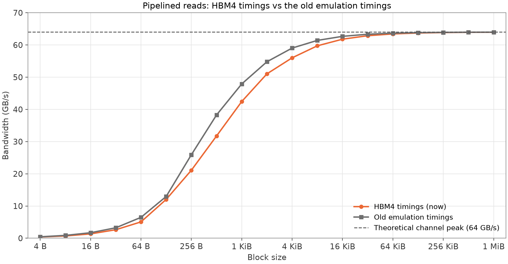

# Local HBM bandwidth: pipelined contiguous reads

How fast can one cluster read from its local HBM channel when it keeps the DMA
busy? The DM core of cluster 0 copies contiguous blocks from HBM 0 into TCDM,
from **4 B to 1 MiB** (doubling each time: 19 sizes; 15 samples up to 8 KiB,
3 above). It is the
[sequential sweep](../app_dram_bandwidth_sequential/README.md) with eight
copies in flight instead of one.

> **Simulator setup.** DRAMSys with the repository's HBM4 timings (from
> Ramulator 2), asynchronous wide-port arbiter, and iDMA writing
> read data to TCDM in 512 B chunks
> ([why](../app_dram_bandwidth_sequential/README.md#simulator-fixes)). Until
> 2026-11-26 the runs used the old emulation timings, 4–5× shorter
> ([what changed](#hbm4-timings-vs-the-old-ones)).

## What is measured

Each sample issues eight consecutive copies back to back and waits once, so the
DMA always has the next one queued; the sequential app waits after every copy.
The core times from the first request to the end of the last copy:

**bandwidth = 8 × block size / elapsed time**

Every sample reads its own window, starting at 4 MiB in channel 0 and aligned
to a 32 B burst, so nothing is read twice. Before each sample, an untimed
pseudo-random wait of 0–3.9 µs keeps the samples from locking onto the DRAM
refresh ([why](../app_dram_bandwidth_sequential/README.md#why-small-copies-are-noisy)).
After timing, the app checks that TCDM holds the last block (an address tag in
its first word), and `summarize.py` rejects partial runs, errors, wrong offsets
and overlapping windows. Blocks up to 512 KiB land at TCDM offset `0x40000`; a
1 MiB block fills the whole TCDM.

## Build and run

From the SDK root, after the [SoftHier setup](../../../README.md); the
simulation takes about 15 minutes. DRAMSys must read the repository's
`dramsys_configs/` but not the prebuilt `libDRAMSys_Simulator.so` next to it,
which is linked against SystemC 2.3.3: the first lines copy the configs alone.

```bash
set -e
mkdir -p .local-artifacts/dramsys
cp -r add_dramsyslib_patches/dramsys_configs .local-artifacts/dramsys/
export DRAMSYS_PATH="$PWD/.local-artifacts/dramsys"
APP_DIR="$PWD/pulp/pulp/chips/softhier/common/sw/app_dram_bandwidth_pipelined"
make sh-hw TOPOLOGY=2d_mesh
make sh-sw TOPOLOGY=2d_mesh app="$APP_DIR"
mkdir -p .local-artifacts/dram-bandwidth-pipelined
RUN_DIR="$(mktemp -d "$PWD/.local-artifacts/dram-bandwidth-pipelined/run.XXXXXX")"
cp sw_build/softhier.elf "$RUN_DIR/softhier.elf"
make sh-run TOPOLOGY=2d_mesh SH_TRACE_ARGS= RUN_ARGS="--work-dir=$RUN_DIR" \
    > "$RUN_DIR/simulation.log" 2>&1
python3 "$APP_DIR/summarize.py" "$RUN_DIR/simulation.log" \
    --report "$RUN_DIR/report.md" > "$RUN_DIR/bandwidth.csv"
python3 "$APP_DIR/query_dram.py" "$RUN_DIR/simulation.log" "$RUN_DIR" \
    > "$RUN_DIR/dram.csv"
rm -f "$RUN_DIR"/*.tdb
pulp/.venv/bin/python "$APP_DIR/plot.py" "$RUN_DIR"
```

A good run ends with `[dram-pipelined] errors=0` and
`SoftHier pipelined DRAM bandwidth: OK`. `query_dram.py` reads the DRAMSys
databases (`DatabaseRecording: true`, on by default); they take several GB and
can go once `dram.csv` exists. Don't start two simulations at the same moment
from one SDK: both rewrite the NoC topology file.

## Results

One run on 2026-11-27; all 201 samples passed the data check. Every chart has
the block size on the horizontal axis, 4 B to 1 MiB. The numbers are in
[bandwidth.csv](assets/data/bandwidth.csv) and [dram.csv](assets/data/dram.csv).

### How fast can one cluster read?


Orange is the bandwidth the core measures, the median of the samples of each
size. The dashed line is the channel's peak, 64 GB/s, and the grey area is the
plateau, where every point is within 5% of the best. The dotted curve is the
model explained [below](#how-far-the-curve-is-from-a-simple-model).

The light band goes from the slowest sample (bottom) to the fastest (top).
**The bottom is a sample that met a DRAM refresh**, which stops the channel for
up to 450 ns: at 4 KiB a sample lasts 0.59 µs and the one with a refresh
1.02 µs, so the band reaches down to 32 GB/s against 56. The longer the sample,
the less a refresh weighs, and from 64 KiB the band is gone: DRAMSys postpones
refreshes while the channel is busy, so none of the three 1 MiB samples, 131 µs
each, contains one (without postponing they would have about 67).

**One cluster saturates its HBM channel.** Bandwidth climbs fast, flattens from
16 KiB and reaches **63.96 GB/s at 1 MiB, 99.94% of the peak**.

| 1 KiB | 4 KiB | 16 KiB | 64 KiB | 1 MiB |
| ---: | ---: | ---: | ---: | ---: |
| 42.45 GB/s | 56.01 GB/s | 61.80 GB/s | 63.43 GB/s | 63.96 GB/s |

### How far the curve is from a simple model

We start from the latency-bandwidth (alpha-beta) model of the
[sequential sweep](../app_dram_bandwidth_sequential/README.md#how-far-the-curve-is-from-a-simple-model):
every copy pays a fixed cost `alpha`, then moves its `N` bytes at bandwidth
`1/beta`.

$$
T(N)=\alpha+\beta N
$$

Fitted on the 64–256 KiB points (time per copy = sample time / 8), it gives
**`alpha = 9.125 ns` per copy and `1/beta = 64.000 GB/s`**, the channel's peak.
**From 4 KiB to 1 MiB it predicts every time to the picosecond**, even at
512 KiB and 1 MiB, which were not in the fit.

`alpha` is the latency of a sample shared by its eight copies: 73 ns, of which
61.3 ns pass outside the DRAM's busy window (the first request travelling to
the DRAM and opening its row, the last data travelling back) and 11.5–13 ns
inside it, waiting for rows to open. With the old timings it was 43 ns
(5.375 ns per copy): the first burst now comes 19.5 ns later, exactly the
longer `tRCD` and `RL`. The sequential sweep pays 68.125 ns per copy, 7.5×
more, and that is where pipelining wins on small and medium blocks.

Below 4 KiB the model is close but not exact:

| Block | Measured | Model |
| ---: | ---: | ---: |
| 4 B | 0.40 GB/s | 0.44 GB/s (−9%) |
| 32 B | 2.64 GB/s | 3.32 GB/s (−21%) |
| 64 B | 5.07 GB/s | 6.32 GB/s (−20%) |
| 256 B | 21.11 GB/s | 19.50 GB/s (+8%) |
| 1 KiB | 42.45 GB/s | 40.76 GB/s (+4%) |
| 4 KiB | 56.01 GB/s | 56.01 GB/s (0%) |

The percentages are measured vs model. From 128 B to 2 KiB the copies are
2–8% faster than predicted. Up to 64 B a sample takes 81–101 ns whatever the
size, up to 21% more than the model: the eight requests reach the DRAM a few
ns apart, and the time depends on how fast they arrive, not on the bytes.

### One copy at a time vs eight in flight


Blue is the [sequential sweep](../app_dram_bandwidth_sequential/README.md),
which waits for each copy before starting the next; orange is this one, with
eight in flight.

**Both reach 64 GB/s, but pipelining gets there much sooner.** The gain comes
from waiting less, not from more bandwidth: 3.6× at 256 B, 1.6× at 4 KiB, and
6% at 64 KiB, where a single big copy already keeps the DRAM busy.

| Block | Sequential | Pipelined | Gain |
| ---: | ---: | ---: | ---: |
| 256 B | 5.80 GB/s | 21.11 GB/s | 3.6× |
| 4 KiB | 36.05 GB/s | 56.01 GB/s | 1.6× |
| 64 KiB | 59.98 GB/s | 63.43 GB/s | 1.06× |
| 1 MiB | 63.61 GB/s | 63.96 GB/s | 1.006× |

**For the compiler:** tiles below about 64 KiB need several DMA transfers in
flight (double buffering or more) to get close to the channel bandwidth.

### DRAM bandwidth vs what the cluster sees


Orange is what software gets: bytes copied over the time the core measures.
Green is how hard the DRAM works: bytes on its data bus over the time from its
first burst to its last. (Below 32 B the DRAM still moves whole 32 B bursts, so
green counts more bytes than the copy.)

**The DRAM is nearly flat out already at 1 KiB** (62.3 GB/s) and reaches
**64.0 GB/s at 1 MiB, its physical limit**: one 32 B burst per nanosecond on
each pseudo-channel. The cluster catches up more slowly because of the 73 ns of
latency per sample [above](#how-far-the-curve-is-from-a-simple-model).


Each sample's time split in three: green, the DRAM bus moving data; yellow, the
bus idle between the first and the last burst; purple, the time outside the
DRAM window.

**From 512 B there is little yellow.** With eight copies queued, the DRAM never
waits for the next request; the 3.5–13 ns left per sample are short waits for
rows to open, at the start and when the copy first comes back to a bank it has
already used, 16 KiB later. Up to 256 B, purple is more than half. Compare it
with the
[sequential breakdown](../app_dram_bandwidth_sequential/README.md#dram-bandwidth-vs-what-the-cluster-sees),
where a big yellow area shows the DRAM waiting between copies.

### HBM4 timings vs the old ones



The same firmware with the old emulation timings (grey,
[bandwidth_ccds4.csv](assets/data/bandwidth_ccds4.csv), run on 2026-11-26 at
pulp commit `4e6fc6a`) and the HBM4 timings (orange); the timings themselves
are in the
[sequential guide](../app_dram_bandwidth_sequential/README.md#hbm4-timings-vs-the-old-ones).
**The peak does not move** (63.98 → 63.96 GB/s at 1 MiB). **Below 4 KiB
copies lose 5–22%** (−22% at 64 B, −19% at 256 B, −11% at 1 KiB, −5% at
4 KiB): with eight copies in flight only the first row opening of a sample is
exposed, so the loss is smaller than in the sequential sweep.

## Regenerate the figures

```bash
APP_DIR="$PWD/pulp/pulp/chips/softhier/common/sw/app_dram_bandwidth_pipelined"
pulp/.venv/bin/python "$APP_DIR/plot.py"
```

`plot.py` reads `assets/data/` and writes every chart into `assets/figures/`;
`timings.png` also needs `bandwidth_ccds4.csv`, and the sequential comparison
reads the sequential app's `assets/data/bandwidth.csv` (`--sequential DIR`
changes it). For a new run, `plot.py "$RUN_DIR"` draws the charts next to its
CSVs (`--output-dir` changes this) and skips those whose CSVs are missing. All
DRAM sweep charts share [dram_common/plot_sweep.py](../dram_common/plot_sweep.py).
