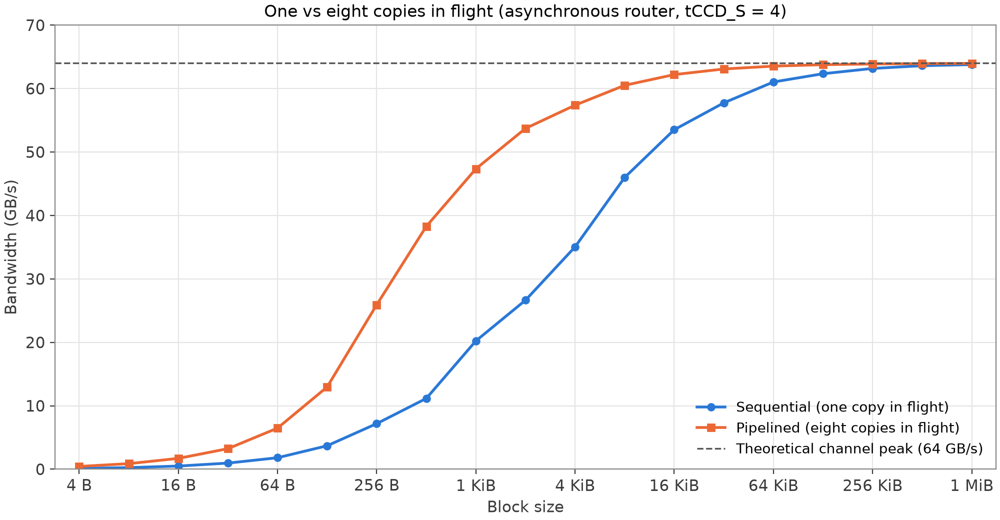

# Local HBM bandwidth: pipelined contiguous reads

What is the highest read bandwidth one cluster sustains from its local HBM
channel? The DM core of cluster 0 reads contiguous blocks from HBM 0 into TCDM,
with block sizes doubling from **4 B to 1 MiB**, the same range as the
[sequential sweep](../app_dram_bandwidth_sequential/README.md): 19 sizes, three
samples each, 57 measurements.

> **Simulator setup.** These results use the asynchronous wide-port arbiter and
> DRAMSys with `CCDS = 4` (see [Build and run](#build-and-run)). The shared
> DRAMSys configuration's `CCDS = 2` lets bursts overlap on the data bus and
> exceed 64 GB/s (see [Why `CCDS = 2` exceeded 64 GB/s](#why-ccds--2-exceeded-64-gbs)).

## What differs from the sequential sweep

Each sample issues eight consecutive blocks back to back and waits once, so
the DMA always has the next copy queued. The sequential app waits after every
copy, which leaves the DMA idle for the latency of each one. Every sample reads
its own consecutive window, starting at 4 MiB in channel 0, so no block is read
twice; windows start on a 32 B DRAM burst.

## What is timed

**Bandwidth = 8 × block size / elapsed time**, from issuing the first copy to
the end of the last one, including clock reads. Setup, checks and printing are
untimed. After timing, the buffer must hold the last block, identified by an
address tag in its first word. Blocks up to 512 KiB land at TCDM offset
`0x40000`; a 1 MiB block fills the whole TCDM (the app has no persistent `.l1`
data and does not use the runtime's barrier words). `summarize.py` rejects
partial runs, errors, wrong offsets and overlapping windows.

## Build and run

From the **SDK root**, after the [SoftHier setup](../../../README.md). No
`sh-data` is needed; the simulation takes about 15 minutes. The results below
use `CCDS = 4`: copy `dramsys_configs/` from the directory `DRAMSYS_PATH`
points to, set `"CCDS": 4` in `memspec/HBM4-emulation-4000.json`, and export
`DRAMSYS_PATH` pointing at the copy before `make sh-run`.

```bash
set -e
APP_DIR="$PWD/pulp/pulp/chips/softhier/common/sw/app_dram_bandwidth_pipelined"
make sh-hw TOPOLOGY=2d_mesh
make sh-sw TOPOLOGY=2d_mesh app="$APP_DIR"
mkdir -p .local-artifacts/dram-bandwidth-pipelined
RUN_DIR="$(mktemp -d "$PWD/.local-artifacts/dram-bandwidth-pipelined/run.XXXXXX")"
cp sw_build/softhier.elf "$RUN_DIR/softhier.elf"
make sh-run TOPOLOGY=2d_mesh SH_TRACE_ARGS= RUN_ARGS="--work-dir=$RUN_DIR" \
    > "$RUN_DIR/simulation.log" 2>&1
python3 "$APP_DIR/summarize.py" "$RUN_DIR/simulation.log" \
    --report "$RUN_DIR/report.md" > "$RUN_DIR/bandwidth.csv"
python3 "$APP_DIR/query_dram.py" "$RUN_DIR/simulation.log" "$RUN_DIR" \
    > "$RUN_DIR/dram.csv"
rm -f "$RUN_DIR"/*.tdb
pulp/.venv/bin/python "$APP_DIR/plot.py" "$RUN_DIR"
```

A valid run ends with `[dram-pipelined] errors=0` and
`SoftHier pipelined DRAM bandwidth: OK`. `query_dram.py` needs
`DatabaseRecording: true` in DRAMSys (the default in the shared configuration);
it attributes the DRAM traffic of every sample, and the `.tdb` databases
(several GB) can go once `dram.csv` exists. Two simulations must not start at
the same moment from one SDK: both regenerate the NoC topology file at startup.

## Results

All figures below share the same horizontal axis: the block size, from 4 B to
1 MiB, doubling at each point. They come from one run on 2026-11-23
(asynchronous wide-port arbiter, DRAMSys with `CCDS = 4`). All 57 samples
passed the data check. The numbers are in [assets/bandwidth.csv](assets/bandwidth.csv)
and [assets/dram.csv](assets/dram.csv).

### How fast can one cluster read?


**What it shows.** The bandwidth the cluster gets for each block size, measured
by the core from the first DMA request to the end of the last copy. The dashed
line is the channel's theoretical peak, 64 GB/s. The grey area is the plateau:
from there on, every point is within 5% of the best one. The dotted curve is a
simple model, explained [below](#how-far-the-curve-is-from-a-simple-model).

**What to take away.** Bandwidth climbs quickly and flattens at 16 KiB. At
1 MiB the cluster reads at **63.97 GB/s, 99.96% of the peak**. In other words, a
single cluster can saturate its local HBM channel. From 4 KiB up the measured
curve sits exactly on the model; below 4 KiB it moves away from it, first
above and then below.

| Plateau from | 1 KiB | 4 KiB | 16 KiB | 64 KiB | 1 MiB |
| ---: | ---: | ---: | ---: | ---: | ---: |
| 16 KiB | 47.35 GB/s | 57.39 GB/s | 62.21 GB/s | 63.54 GB/s | 63.97 GB/s |

The three samples of each size agree closely (the light band around the curve
is their min–max, at most 0.7% wide from 1 KiB up). The 64 B–512 KiB values
match the earlier run of this app, which stopped at 512 KiB, except 128 B
(one 1 ns tick in a 79 ns sample).

### How far the curve is from a simple model

We use the same latency-bandwidth (alpha-beta/Hockney) model as the
[sequential sweep](../app_dram_bandwidth_sequential/README.md#how-the-asymptote-is-calculated),
on the median time per copy (sample time / 8):

$$
T(N)=\alpha+\beta N,\qquad B_{\infty}=1/\beta.
$$

In words: every copy pays a fixed cost `alpha`, then moves its `N` bytes at
bandwidth `1/beta`. Fitting the 64, 128 and 256 KiB points gives
**`alpha = 7.375 ns` per copy and `1/beta = 64.000 GB/s`**, exactly the
channel's peak.

**From 4 KiB to 1 MiB the model is exact.** Every predicted time matches the
measured one to the picosecond, including the 512 KiB and 1 MiB points that
were left out of the fit. Here the cluster behaves like an ideal pipe: a fixed
cost, then the bytes at 64 GB/s.

**What `alpha` means.** With eight copies in flight the fixed cost is paid
once per sample, not once per copy: 8 × 7.375 = **59 ns per sample**. That is
the 56.5 ns spent outside the DRAM bus window (see
[below](#dram-bandwidth-vs-what-the-cluster-sees)) plus 2.5 ns by which the bus
window is longer than the bytes alone would take. The sequential sweep pays
`alpha = 50.125 ns` per copy instead: pipelining cuts the fixed cost of each
copy by 6.8×, which is where its advantage on small and mid-size blocks comes
from.

**Below 4 KiB the curve leaves the model, in two different ways:**

| Block | Measured | Model | Measured vs model |
| ---: | ---: | ---: | ---: |
| 32 B | 3.24 GB/s | 4.06 GB/s | −20% |
| 64 B | 6.48 GB/s | 7.64 GB/s | −15% |
| 256 B | 25.92 GB/s | 22.51 GB/s | +15% |
| 512 B | 38.28 GB/s | 33.30 GB/s | +15% |
| 1 KiB | 47.35 GB/s | 43.81 GB/s | +8% |
| 4 KiB | 57.39 GB/s | 57.39 GB/s | 0% |

- **Up to 128 B, slower than the model.** A sample takes 73–79 ns whatever
  the block size. The eight requests reach the DRAM about 4.5 ns apart (at
  4 B the bus window lasts 31 ns for 8 ns of data), so the time is set by
  how fast the copies arrive, not by the bytes. The model has no term for this.
- **From 256 B to 2 KiB, faster than the model.** Here the time outside the
  DRAM bus window is about 42 ns instead of 56.5 ns
  ([fixed cost chart](#dram-bandwidth-vs-what-the-cluster-sees)), so the
  fixed cost is smaller than the `alpha` fitted on large blocks.

So the model tells you what to expect from 4 KiB up, and only an upper or
lower bound below. The sequential sweep shows the same split at 4 KiB, but
there small copies only ever beat the model.

### One copy at a time vs eight in flight



**What it shows.** The same reads done two ways. Blue: the
[sequential sweep](../app_dram_bandwidth_sequential/README.md) waits for each
copy before starting the next. Orange: this sweep queues eight copies and
waits once.

**What to take away.** Both reach the same 64 GB/s ceiling, but the pipelined
curve gets there much earlier. The difference is not bandwidth, it is how
much waiting the cluster does. Small blocks gain the most: 3.4–3.6× up to
512 B, 1.6× at 4 KiB. From 64 KiB up the gain is below 4%, because a single
large copy already keeps the DRAM busy on its own.

| Block | Sequential | Pipelined | Pipelined / sequential |
| ---: | ---: | ---: | ---: |
| 256 B | 7.19 GB/s | 25.92 GB/s | 3.6× |
| 1 KiB | 20.23 GB/s | 47.35 GB/s | 2.3× |
| 4 KiB | 35.05 GB/s | 57.39 GB/s | 1.6× |
| 16 KiB | 53.52 GB/s | 62.21 GB/s | 1.16× |
| 64 KiB | 61.04 GB/s | 63.54 GB/s | 1.04× |
| 1 MiB | 63.79 GB/s | 63.97 GB/s | 1.003× |

**For the compiler:** tiles below about 64 KiB need several DMA transfers in
flight (double buffering or more) to get close to the channel bandwidth.
Larger tiles get there even if each transfer is awaited.

### DRAM bandwidth vs what the cluster sees

The bandwidth above is measured by the core, so it includes everything: the
request travelling to the DRAM, the DRAM itself, and the data coming back. To
see the DRAM on its own we also read the DRAMSys records, which tell exactly
when each 32 B burst used the DRAM data bus.


**What it shows.** Two bandwidths for the same samples:

- **Orange, end to end:** bytes copied / time measured by the core. This is
  what software gets.
- **Green, DRAM data bus:** bytes the DRAM transferred / time from the first
  burst to the last one on the data bus. This is how hard the DRAM itself is
  working. (Below 32 B the DRAM still reads a whole 32 B burst, so the green
  curve counts more bytes than the copy.)

**What to take away.** The DRAM is already flat out with 1 KiB blocks:
63.4 GB/s at 1 KiB, 63.7 GB/s at 4 KiB and **64.00 GB/s at 1 MiB, exactly the
channel's physical limit** (one 32 B burst per nanosecond on each of the two
pseudo-channels). The cluster's curve catches up more slowly. The next chart
shows why.


**What it shows.** For each sample, the core's measured time minus the DRAM's
busy window: the time spent before the first burst (the request travelling to
the DRAM) and after the last one (the data travelling back).

**What to take away.** From 4 KiB to 1 MiB this extra time is **56.5 ns, always
the same**, whatever the block size. It is a fixed latency, not a lower
bandwidth: it weighs 10% on a 4 KiB sample and 0.04% on a 1 MiB one. That
alone explains the whole curve: `time = 8 × block / 64 GB/s + 56.5 ns`
predicts 57.6 GB/s at 4 KiB (57.39 measured) and 63.97 GB/s at 1 MiB (63.97
measured). Below 4 KiB the extra time is shorter, about 42 ns, and grows by
about 2 ns per 512 B up to 4 KiB (the largest burst the iDMA sends). We have
not traced why yet; it looks like the last burst's data crossing the
interconnect after the DRAM is done.


**What it shows.** Each sample's time split into three parts, as a share of
the total: green, the DRAM bus moving data; yellow, the DRAM bus sitting idle
between the first and the last burst; purple, the time outside the DRAM
window (request going out, data coming back).

**What to take away.** With eight copies in flight there is almost no yellow:
the DRAM never waits for the next request (at most 3.3 ns per sample). For
large blocks the green covers practically everything; for small blocks the
purple fixed latency dominates (more than half the time up to 256 B). Compare
it with the [sequential breakdown](../app_dram_bandwidth_sequential/README.md#dram-bandwidth-vs-what-the-cluster-sees),
where a large yellow area shows the DRAM waiting for the cluster between copies.

## Why `CCDS = 2` exceeded 64 GB/s

Before the fix, this sweep measured more than the theoretical peak, which
should be impossible. The cause was one DRAMSys timing parameter.


**What it shows.** End-to-end bandwidth with the shared DRAMSys configuration
(`CCDS = 2`, grey) and with the corrected one (`CCDS = 4`, orange).

**What to take away.** The curves almost overlap, but the grey one ends above
the 64 GB/s line (64.22 GB/s at 1 MiB). The difference is small, but it is
enough to put a measurement above a physical limit.


**What it shows.** The same comparison on the DRAM data bus.

**What to take away.** With `CCDS = 2` the DRAM bus itself goes above the
physical limit, up to **67.4 GB/s at 512 B**. That can only happen if two
bursts use the bus at the same time. With `CCDS = 4` the bus never goes above
64.0 GB/s.

| | `CCDS = 2` (shared configuration) | `CCDS = 4` |
| --- | ---: | ---: |
| Plateau from | 16 KiB | 16 KiB |
| End to end, 4 KiB | 58.00 GB/s | 57.39 GB/s |
| End to end, 1 MiB | **64.22 GB/s** | 63.97 GB/s |
| DRAM bus, 1 MiB | **64.25 GB/s** | 64.00 GB/s |
| Bus occupancy per pseudo-channel, 1 MiB | **100.4%** | 100.0% |
| Bus occupancy per pseudo-channel, 1 KiB | **102.6–103.4%** | 99.0% |

An occupancy above 100% means two bursts shared the data bus. End to end,
`CCDS = 2` is faster by nothing up to 64 B, 0–3.9% from 128 B to 512 B,
1.1–2.4% at 1–4 KiB, and 0.4% from 128 KiB up. In the earlier 64 B–512 KiB run,
5355 of the 65536 bursts of a 512 KiB sample (8%) started only 0.5 ns after
the previous one on the same pseudo-channel.

**Why it happened.** The HBM4 emulation is configured as HBM2, which DRAMSys supports, with 8-beat
bursts (`tBURST` = 4 cycles = 1 ns) but a bank-group-to-bank-group column
spacing `CCDS` of 2 cycles, the HBM2 value for 4-beat bursts (DRAMSys's own
`HBM2.json` uses BL4 with `CCDS = 2`). `CheckerHBM2.cpp` spaces consecutive
reads on a pseudo-channel only by `tCCDL` (same bank group) and `tCCDS`
(different bank group); `tBURST` does not enter that check, which assumes
`tCCDS >= tBURST`. With `CCDS = 2`, some bursts start 0.5 ns after the previous
one, always in a different bank group, and share the bus with it.

**The fix.** With `CCDS = 4` every overlap disappears: each pseudo-channel carries one burst
per nanosecond and the bus delivers exactly 64.0 GB/s. Row changes are hidden by
bank parallelism, and refreshes are postponed out of these short samples
(`RefreshMaxPostponed` allows 128, about 160 µs; the longest sample takes
131 µs); a longer continuous stream would pay for them, up to about 5%
(`tRFC / tREFI` = 65 ns / 1.25 µs).

## Regenerate the figures

```bash
APP_DIR="$PWD/pulp/pulp/chips/softhier/common/sw/app_dram_bandwidth_pipelined"
pulp/.venv/bin/python "$APP_DIR/plot.py"
```

`plot.py` reads the CSVs in `assets/` and redraws, one chart per image,
`bandwidth.png`; `dram_vs_end_to_end.png`, `fixed_cost.png` and
`time_breakdown.png` (from `dram.csv`); `ccds.png` (from `bandwidth_ccds2.csv`)
and `ccds_bus.png` (from `dram_ccds2.csv`); and `sequential_vs_pipelined.png`
(with the sequential app's `assets/bandwidth.csv`;
`--sequential DIR` points elsewhere). For a new run,
`plot.py "$RUN_DIR"` reads `bandwidth.csv` and `dram.csv` there and writes the
figures next to them (`--output-dir` changes this); figures whose CSVs are
missing are skipped. All DRAM sweep figures share
[dram_common/plot_sweep.py](../dram_common/plot_sweep.py), which fixes the
4 B–1 MiB axis.
