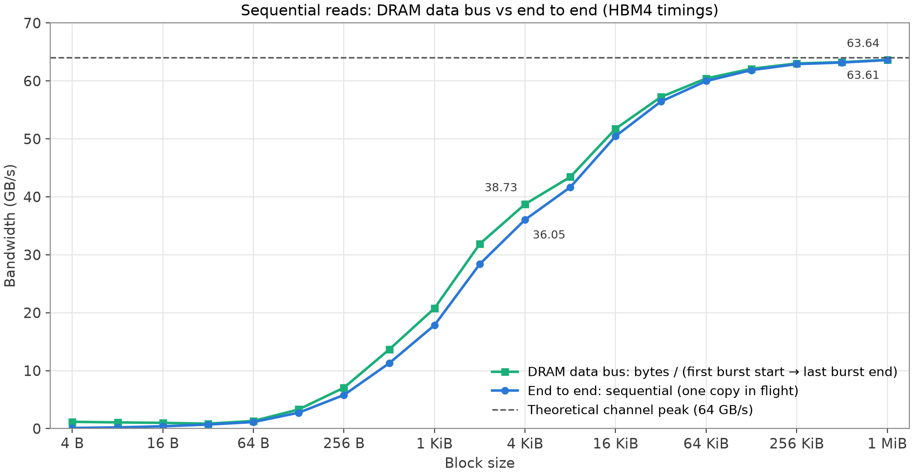
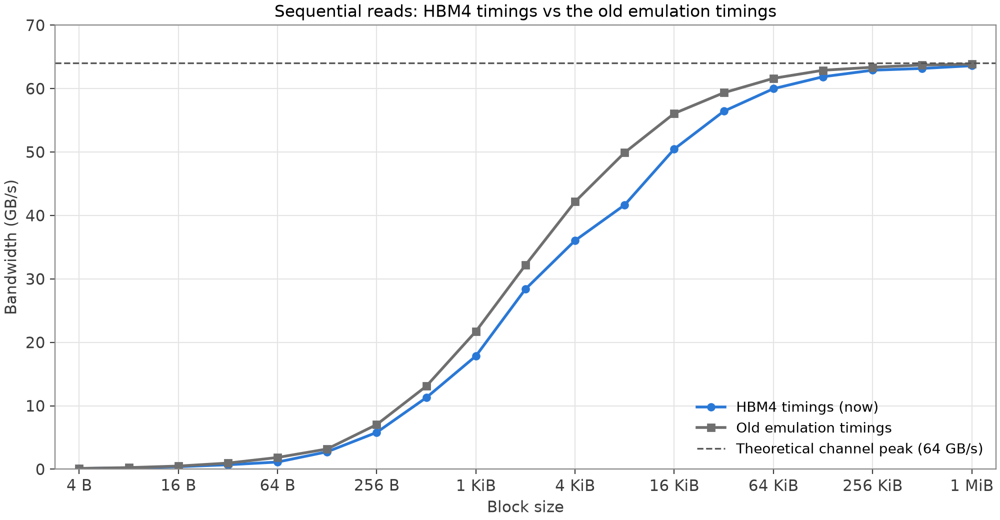
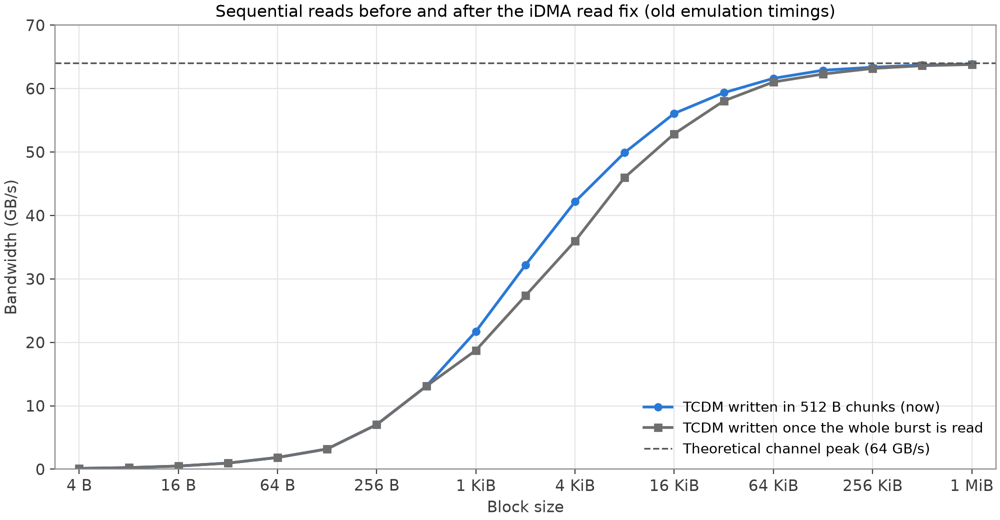

# Local HBM bandwidth: sequential reads

How fast can one cluster read from its local HBM channel if it waits for every
copy before starting the next? The DM core of cluster 0 copies blocks from
HBM 0 into TCDM, from **4 B to 1 MiB** (doubling each time: 19 sizes; 15
samples of eight copies up to 8 KiB, 3 above). The
[pipelined sweep](../app_dram_bandwidth_pipelined/README.md) does the same
with eight copies in flight. (Until 2026-11-23 this app was called
`app_dram_bandwidth_streaming`; older logs print `pattern=streaming` and are
still accepted.)

> **Simulator setup.** DRAMSys with the repository's HBM4 timings (from
> Ramulator 2), asynchronous wide-port arbiter, and iDMA writing
> read data to TCDM in 512 B chunks. Until 2026-11-26 the runs used the old
> emulation timings, 4–5× shorter ([what changed](#hbm4-timings-vs-the-old-ones));
> the [simulator fixes](#simulator-fixes) were measured with those.

## What is measured

A sample copies eight consecutive blocks starting at a fresh address `A`,
waiting for each copy before issuing the next:

```text
time A, A+N, A+2N, ..., A+7N   (one copy in flight)
```

**bandwidth = 8 × block size / elapsed time**, including DMA issue, waits and
clock reads; setup, checks and printing are untimed. Every sample reads its own
window, so no block is read twice (consecutive blocks can still hit open rows).
Before each sample, an untimed pseudo-random wait of 0–3.9 µs keeps the samples
from locking onto the DRAM refresh ([why](#why-small-copies-are-noisy)).

Before timing, untimed DMA writes fill the source with a pattern and tag each
block with its address, then a 100 µs wait lets them drain. After timing, the
buffer is checked against the last block. Up to 512 KiB, copies land at TCDM
offset `0x20000`; a 1 MiB copy uses the whole TCDM. Buffer layout:
[bandwidth.h](bandwidth.h).

## Build and run

From the SDK root, after the [SoftHier setup](../../../README.md); the
simulation takes about 15 minutes. DRAMSys must read the repository's
`dramsys_configs/` but not the prebuilt `libDRAMSys_Simulator.so` next to it,
which is linked against SystemC 2.3.3: the first lines copy the configs alone.

```bash
set -e
mkdir -p .local-artifacts/dramsys
cp -r add_dramsyslib_patches/dramsys_configs .local-artifacts/dramsys/
export DRAMSYS_PATH="$PWD/.local-artifacts/dramsys"
APP_DIR="$PWD/pulp/pulp/chips/softhier/common/sw/app_dram_bandwidth_sequential"
make sh-hw TOPOLOGY=2d_mesh
make sh-sw TOPOLOGY=2d_mesh app="$APP_DIR"
mkdir -p .local-artifacts/dram-bandwidth-sequential
RUN_DIR="$(mktemp -d "$PWD/.local-artifacts/dram-bandwidth-sequential/run.XXXXXX")"
cp sw_build/softhier.elf "$RUN_DIR/softhier.elf"
make sh-run TOPOLOGY=2d_mesh SH_TRACE_ARGS= RUN_ARGS="--work-dir=$RUN_DIR" \
    > "$RUN_DIR/simulation.log" 2>&1
python3 "$APP_DIR/summarize.py" "$RUN_DIR/simulation.log" \
    --report "$RUN_DIR/report.md" > "$RUN_DIR/bandwidth.csv"
python3 "$APP_DIR/query_dram.py" "$RUN_DIR/simulation.log" "$RUN_DIR" \
    > "$RUN_DIR/dram.csv"
```

A good run ends with `[dram-bandwidth] errors=0` and
`SoftHier DRAM bandwidth: OK`; the summary rejects incomplete runs.
`query_dram.py` reads the DRAMSys databases (`DatabaseRecording: true`, on by
default); they take 2–4 GB and can go once `dram.csv` exists.

The summary also reports the plateau: it exists when the last three medians
differ by at most 3%, and starts at the first size from which every median
stays within 5% of the best. The reference is **64 GB/s**, the bus bandwidth of
one HBM channel (two 32-bit pseudo-channels at 8 Gbit/s per pin);
`--peak-gbps` changes it.

## Results

One run on 2026-11-27; all 201 samples passed the data check. Every chart has
the block size on the horizontal axis, 4 B to 1 MiB. The numbers are in
[bandwidth.csv](assets/data/bandwidth.csv) and [dram.csv](assets/data/dram.csv).

### How fast is one copy at a time?


Blue is the bandwidth the core measures, the median of the samples of each
size. The dashed line is the channel's peak, 64 GB/s, the grey area the plateau
(every point within 5% of the best). The dotted curve is the model explained
[below](#how-far-the-curve-is-from-a-simple-model).

The light band goes from the slowest sample (bottom) to the fastest (top).
**The bottom is a sample that met a DRAM refresh**, which stops the channel for
up to 450 ns: at 1 KiB a sample lasts 0.46 µs and the one with a refresh
0.90 µs, so the band reaches down to 9.2 GB/s against 17.9. The band is wide up
to 8 KiB, where samples last less than 1.6 µs, and disappears from 16 KiB: a
refresh weighs less on a longer sample, and DRAMSys postpones refreshes while
the channel is busy ([more below](#why-small-copies-are-noisy)).

**Small copies are slow, because each one waits for its whole round trip to
the DRAM.** Bandwidth flattens from 128 KiB and reaches **63.61 GB/s at 1 MiB,
99.4% of the peak**.

| 1 KiB | 4 KiB | 16 KiB | 64 KiB | 1 MiB |
| ---: | ---: | ---: | ---: | ---: |
| 17.85 GB/s | 36.05 GB/s | 50.47 GB/s | 59.98 GB/s | 63.61 GB/s |

### How far the curve is from a simple model

We fit the latency-bandwidth (alpha-beta) model to the median time per copy:
every copy pays a fixed cost `alpha`, then moves its `N` bytes at bandwidth
`1/beta`.

$$
T(N)=\alpha+\beta N
$$

On the 64, 128 and 256 KiB points it gives **`alpha = 68.125 ns` and
`1/beta = 63.942 GB/s`** (64.06 ns per 4 KiB burst). **From 8 KiB up it is
within 0.2% of every point**, including 512 KiB and 1 MiB, which were not in
the fit.

`alpha` was 37.125 ns with the old timings. The 31 ns more are the DRAM row: a
large copy starts by closing the row left open in its bank and opening its own,
and `tRP + tRCD + RL` went from 12.5 to 46 ns.

Below 8 KiB the model is pessimistic: the copies are faster than predicted.

| Block | Measured | Model |
| ---: | ---: | ---: |
| 4 B | 0.11 GB/s | 0.06 GB/s (+94%) |
| 64 B | 1.13 GB/s | 0.93 GB/s (+22%) |
| 512 B | 11.28 GB/s | 6.73 GB/s (+68%) |
| 1 KiB | 17.85 GB/s | 12.17 GB/s (+47%) |
| 4 KiB | 36.05 GB/s | 30.99 GB/s (+16%) |
| 8 KiB | 41.66 GB/s | 41.74 GB/s (−0.2%) |

The percentages are measured vs model. **Small copies find their row already
open.** A DRAM row holds 1 KiB, spread over 8 KiB of addresses (64 B every
512 B), so consecutive small copies fall in the same rows and most of them skip
the row change that every large copy pays: a 4 B copy takes 35 ns and a 1 KiB
copy 57 ns, where the model says 68 and 84 ns.

### Why small copies are noisy

Each pseudo-channel is refreshed every 3.9 µs (`tREFI`), and a refresh blocks
it for 450 ns (`tRFC`); the two pseudo-channels take turns, so the channel
meets a refresh every 1.95 µs. (The old timings had 65 ns every 1.25 µs.) In
the DRAMSys database, 57 of the 180 samples up to 8 KiB had a refresh inside
their window, which made them up to 0.5 µs slower (0.23 µs median); the others
were within 60 ns of the fastest sample of their size.

**The samples must not lock onto the refresh.** Without the random wait, the
time between two samples of a size is constant: at 1 KiB it was 11.70 µs,
exactly three `tREFI`, so once a refresh fell in a sample it fell in all the
next ones, and only 2 of 15 samples were clean. With the wait, the samples
spread over the refresh period, and the median is within 1.5% of the fastest
sample at every size but 1 KiB (7% below it).

So up to 8 KiB the medians show copies without a refresh. Long copies hardly
meet any: DRAMSys postpones up to 128 refreshes while the channel is busy, so a
132 µs sample contains at most one, where about 67 are due. A stream longer
than about 0.5 ms (128 × 3.9 µs) would pay them back, up to 11.5% of the time.

### DRAM bandwidth vs what the cluster sees



Blue is what software gets: bytes copied over the time the core measures.
Green is how hard the DRAM works: bytes on its data bus over the time from its
first burst to its last. (Below 32 B the DRAM still moves a whole 32 B burst per
copy, so green counts more bytes than the copy.)

**The two curves meet at the top** (63.64 GB/s on the DRAM bus, 63.61 GB/s for
the cluster at 1 MiB), **but for mid-size copies even the DRAM is far from its
limit**: 38.7 GB/s at 4 KiB. With one copy at a time, the DRAM spends part of
its window waiting. In the
[pipelined sweep](../app_dram_bandwidth_pipelined/README.md#dram-bandwidth-vs-what-the-cluster-sees)
it does not.


Each sample's time split in three: green, the DRAM bus moving data; yellow, the
bus idle between the first and the last burst; purple, the time outside the
DRAM window.

**The big yellow area is the price of waiting for each copy.** Between two
copies the DRAM sits idle while the next request travels and opens its row:
210–485 ns per sample up to 8 KiB. At 4 KiB the DRAM is busy only 56% of the
time, and up to 512 B at most 18%. Yellow shrinks only because large copies
make the gaps negligible; the pipelined sweep removes it by keeping eight
copies queued.

### HBM4 timings vs the old ones



The same firmware with the old emulation timings (grey,
[bandwidth_ccds4.csv](assets/data/bandwidth_ccds4.csv), run on 2026-11-25) and
the HBM4 timings (blue). The HBM4 rows take much longer to open and close, and
refresh blocks the channel longer:

| | Old | HBM4 |
| --- | ---: | ---: |
| `tRCD`, open a row | 2.5 ns | 19.5 ns |
| `tRP`, close a row | 2.5 ns | 16.5 ns |
| `RL`, read latency | 7.5 ns | 10 ns |
| `tFAW`, window for four row openings | 2 ns | 15 ns |
| `tRFC` every `tREFI` | 65 ns every 1.25 µs | 450 ns every 3.9 µs |

**The peak does not move** (63.86 → 63.61 GB/s at 1 MiB): a long copy keeps
the banks busy and hides the row openings. **Below 16 KiB copies lose 10–40%**
(−39% at 64 B, −18% at 1 KiB, −15% at 4 KiB, −10% at 16 KiB), because each
copy waits for its row; from 64 KiB the loss is under 3%.

## Simulator fixes

Two parts of GVSoC made the curve look worse than hardware would. Both are
fixed in the runs above. **This section was measured with the old emulation
timings**, so its curves end at 63.86 GB/s.

### Wide-port arbiter

Each cluster's iDMA reaches the NoC through `wide_arbiter_<cluster>`
([softhier_system_base.py](../../../softhier_system_base.py)), a router with
`bandwidth=noc_link_width` (512 B/cycle) that models the cluster's wide AXI port.

**The synchronous router (previous default) counted the queueing twice.** It
charged a read burst's data when the *request* passed
(`BandwidthLimiter::apply_bandwidth` in `core/models/interco/router/router.cpp`)
and stored the wait in the request's latency. The iDMA issues one 4 KiB burst
per cycle, each counted as 8 cycles, so burst *k* got 7·k cycles of latency.
The DRAM then served the bursts at its own pace, and the iDMA AXI backend
(`pulp/idma/be/idma_be_axi.cpp`) added that latency on top of the real
response. Each 4 KiB burst cost 63.75 ns of DRAM time plus 7 ns:
4096 / 70.75 ≈ 57.9 GB/s. In hardware the data comes back on the R channel
while the DRAM works, so nothing adds up.

**The asynchronous router (`synchronous=False`, current) counts it once.**
Requests queue and leave the port spaced by its bandwidth; responses pass
straight back. Against a DRAM that serves one burst every ~64 ns the spacing
costs nothing, while a fast target would still be limited to 512 B/cycle. It
is not a beat-accurate AXI model, since it throttles requests rather than the
R channel, but the throughput is right.

To see the difference in a trace, run with
`--trace=/system/cluster_0/idma/axi_read --trace-level=trace`: the lines
`Handling end of read request (... latency N)` grow by 7 per burst with the
synchronous router and stay at 0 with the asynchronous one.

### iDMA read data in chunks

The iDMA splits a copy into AXI bursts of up to 4 KiB. **Before the fix, a
read burst was answered in one piece:** the DRAMSys bridge
(`core/models/memory/dramsys.cpp`) replies only when all 128 of its 32 B
accesses are done, and only then did the iDMA write the burst into TCDM, one
512 B line every 2 cycles. So after the DRAM had sent its last byte, the copy
still waited up to 8 line writes, 16 ns for a 4 KiB burst.

In hardware the data comes back as R beats, and the iDMA writes them into TCDM
while the rest of the burst is still on its way: only the last line is left
at the end. **Now the iDMA reads each burst in 512 B chunks** (one TCDM line),
each answered and written on its own (`read_chunk_size` in
`pulp/idma/be/idma_be_axi.cpp`). The chunks of a burst still count as one
outstanding burst. To get the old behaviour back, run with
`--config-opt system/idma_read_chunk=0`.



The same firmware with the old iDMA (grey) and the new one (blue), from
[bandwidth_whole_burst.csv](assets/data/bandwidth_whole_burst.csv) and
[bandwidth_ccds4.csv](assets/data/bandwidth_ccds4.csv).

**The fix matters between 1 and 64 KiB.** Up to 512 B every sample is
identical, to the picosecond: a burst that fits in one line had nothing to
wait for. From 1 KiB each copy saves one line write per extra 512 B of its
last burst, up to 14 ns from 4 KiB (2 ns at 1 KiB, measured on samples without
a refresh). At 4 KiB that is 17% more bandwidth; at 1 MiB, 0.1%. The DRAM side
does not change.

| Block | Whole burst | 512 B chunks | Gain |
| ---: | ---: | ---: | ---: |
| 1 KiB | 18.75 GB/s | 21.73 GB/s | +16% |
| 4 KiB | 35.97 GB/s | 42.17 GB/s | +17% |
| 16 KiB | 52.87 GB/s | 56.09 GB/s | +6% |
| 64 KiB | 61.04 GB/s | 61.62 GB/s | +1% |
| 1 MiB | 63.80 GB/s | 63.86 GB/s | +0.1% |

(Below 16 KiB the medians also move with the refreshes, so the gain there is
± a few %.)

## Regenerate the figures

```bash
APP_DIR="$PWD/pulp/pulp/chips/softhier/common/sw/app_dram_bandwidth_sequential"
pulp/.venv/bin/python "$APP_DIR/plot.py"
```

`plot.py` reads `assets/data/` and writes every chart into `assets/figures/`.
`timings.png` and `read_chunks.png` also need `bandwidth_ccds4.csv`, the
2026-11-25 run with the old timings, and `read_chunks.png` needs
`bandwidth_whole_burst.csv`, the same firmware run with
`--config-opt system/idma_read_chunk=0`. For a new run, `plot.py "$RUN_DIR"`
draws the charts next to its CSVs (`--output-dir` changes this) and skips those
whose CSVs are missing; the fit needs the 64/128/256 KiB points. All DRAM sweep
charts share [dram_common/plot_sweep.py](../dram_common/plot_sweep.py).
