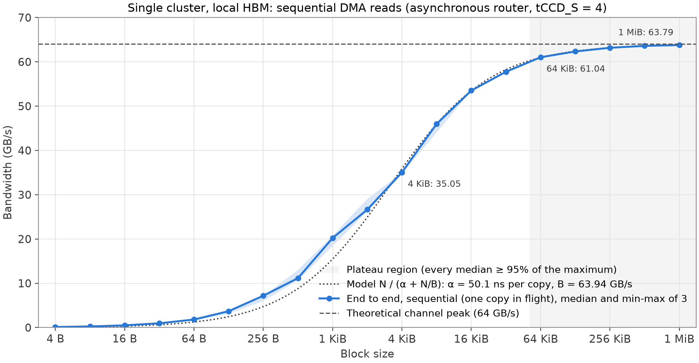
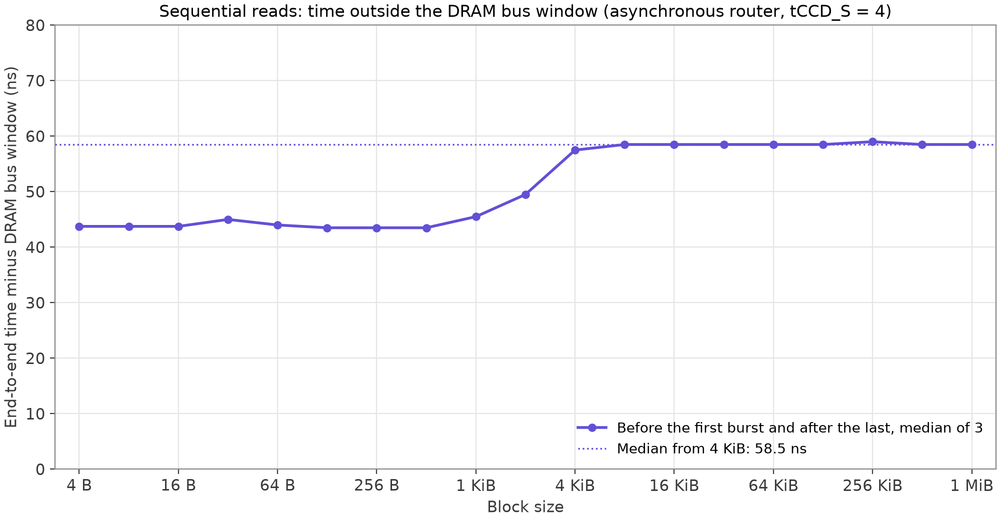
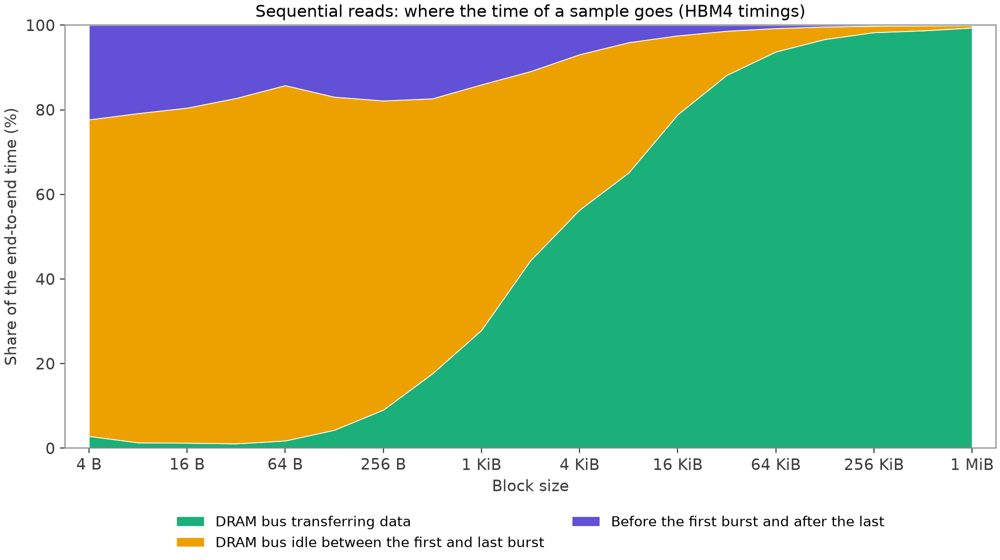
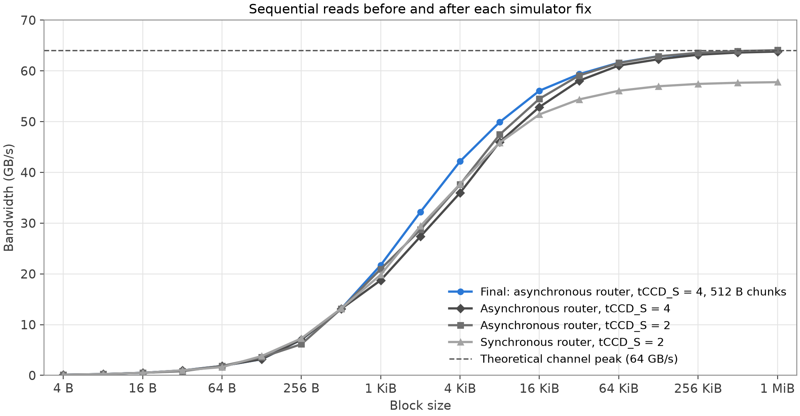

# Local HBM bandwidth: sequential reads

How fast can one cluster read from its local HBM channel if it waits for every
copy before starting the next? The DM core of cluster 0 copies blocks from
HBM 0 into TCDM, from **4 B to 1 MiB** (doubling each time: 19 sizes, three
samples of eight copies each). The
[pipelined sweep](../app_dram_bandwidth_pipelined/README.md) does the same
with eight copies in flight. (Until 2026-11-23 this app was called
`app_dram_bandwidth_streaming`; older logs print `pattern=streaming` and are
still accepted.)

> **Simulator setup.** Asynchronous wide-port arbiter and DRAMSys with
> `CCDS = 4`. The earlier synchronous arbiter capped large copies at about
> 57.9 GB/s through a modelling artifact
> ([Wide-port arbiter model](#wide-port-arbiter-model)), and the shared DRAMSys
> configuration's `CCDS = 2` lets bursts overlap on the data bus and go past
> 64 GB/s ([pipelined guide](../app_dram_bandwidth_pipelined/README.md#why-ccds--2-exceeded-64-gbs)).

## What is measured

A sample copies eight consecutive blocks starting at a fresh address `A`,
waiting for each copy before issuing the next:

```text
time A, A+N, A+2N, ..., A+7N   (one copy in flight)
```

**bandwidth = 8 × block size / elapsed time**, including DMA issue, waits and
clock reads; setup, checks and printing are untimed. Every sample reads its own
window, so no block is read twice (consecutive blocks can still hit open rows).

Before timing, untimed DMA writes fill the source with a pattern and tag each
block with its address, then a 100 µs wait lets them drain. After timing, the
buffer is checked against the last block. Up to 512 KiB, copies land at TCDM
offset `0x20000`; a 1 MiB copy uses the whole TCDM. Buffer layout:
[bandwidth.h](bandwidth.h).

## Build and run

From the SDK root, after the [SoftHier setup](../../../README.md); the
simulation takes about 15 minutes. For `CCDS = 4`, copy `dramsys_configs/` from
where `DRAMSYS_PATH` points, set `"CCDS": 4` in
`memspec/HBM4-emulation-4000.json`, and point `DRAMSYS_PATH` at the copy.

```bash
set -e
APP_DIR="$PWD/pulp/pulp/chips/softhier/common/sw/app_dram_bandwidth_sequential"
make sh-hw TOPOLOGY=2d_mesh
make sh-sw TOPOLOGY=2d_mesh app="$APP_DIR"
mkdir -p .local-artifacts/dram-bandwidth-sequential
RUN_DIR="$(mktemp -d "$PWD/.local-artifacts/dram-bandwidth-sequential/run.XXXXXX")"
cp sw_build/softhier.elf "$RUN_DIR/softhier.elf"
make sh-run TOPOLOGY=2d_mesh SH_TRACE_ARGS= RUN_ARGS="--work-dir=$RUN_DIR" \
    > "$RUN_DIR/simulation.log" 2>&1
python3 "$APP_DIR/summarize.py" "$RUN_DIR/simulation.log" \
    --report "$RUN_DIR/report.md" > "$RUN_DIR/bandwidth.csv"
python3 "$APP_DIR/query_dram.py" "$RUN_DIR/simulation.log" "$RUN_DIR" \
    > "$RUN_DIR/dram.csv"
```

A good run ends with `[dram-bandwidth] errors=0` and
`SoftHier DRAM bandwidth: OK`; the summary rejects incomplete runs.
`query_dram.py` reads the DRAMSys databases (`DatabaseRecording: true`, on by
default); they take 2–4 GB and can go once `dram.csv` exists.

The summary also reports the plateau: it exists when the last three medians
differ by at most 3%, and starts at the first size from which every median
stays within 5% of the best. The reference is **64 GB/s**, the bus bandwidth of
one HBM channel (two 32-bit pseudo-channels at 8 Gbit/s per pin);
`--peak-gbps` changes it.

## Results

One run on 2026-11-22; all 57 samples passed the data check. Every chart has
the block size on the horizontal axis, 4 B to 1 MiB. The numbers are in
[bandwidth.csv](assets/data/bandwidth.csv) and [dram.csv](assets/data/dram.csv).

### How fast is one copy at a time?



Blue is the bandwidth the core measures; the light band around it is the
min–max of the three samples. The dashed line is the channel's peak, 64 GB/s,
the grey area the plateau (every point within 5% of the best), and the dotted
curve a simple model, explained [below](#how-the-asymptote-is-calculated).

**Small copies are slow, because each one waits for its whole round trip to
the DRAM.** Bandwidth flattens from 64 KiB and reaches **63.79 GB/s at 1 MiB,
99.7% of the peak**. Below 4 KiB the three samples differ by up to 23%: a
sample lasts only a few hundred ns, so a few ns of DRAM state change it. From
16 KiB up they agree within 0.5%.

| Block | `CCDS = 2` (2026-11-20) | `CCDS = 4` |
| ---: | ---: | ---: |
| 4 KiB | 37.62 GB/s | 35.05 GB/s |
| 16 KiB | 54.50 GB/s | 53.52 GB/s |
| 64 KiB | 61.56 GB/s | 61.04 GB/s |
| 1 MiB | 64.08 GB/s | 63.79 GB/s |

With the old `CCDS = 2` the 1 MiB point went above the peak, and small copies
looked faster than they are: overlapping bursts shortened each copy's data
phase (a 4 KiB copy took 108.875 ns instead of 116.875 ns).

### How the asymptote is calculated

We fit the latency-bandwidth (alpha-beta) model to the median time per copy:
every copy pays a fixed cost `alpha`, then moves its `N` bytes at bandwidth
`1/beta`.

$$
T(N)=\alpha+\beta N
$$

On the 64, 128 and 256 KiB points it gives **`alpha = 50.125 ns` and
`1/beta = 63.938 GB/s`** (64.06 ns per 4 KiB burst). The 512 KiB and 1 MiB
points, left out of the fit, land within 0.1% of the prediction. `alpha` is an
effective fixed cost, not a separate measurement of DMA startup. (With
`CCDS = 2` the same fit gave 64.251 GB/s, above the peak.)

The model works from 4 KiB up. Smaller copies beat it (1 KiB: 20.2 GB/s
measured, 15.5 GB/s predicted) because their fixed cost is smaller than
`alpha`, as the next section shows.

### DRAM bandwidth vs what the cluster sees


Blue is what software gets: bytes copied over the time the core measures.
Green is how hard the DRAM works: bytes on its data bus over the time from its
first burst to its last. (Below 32 B the DRAM still moves a whole 32 B burst per
copy, so green counts more bytes than the copy.)

**The two curves meet at the top** (63.81 GB/s on the DRAM bus, 63.79 GB/s for
the cluster at 1 MiB), **but for mid-size copies even the DRAM is far from its
limit**: 37.3 GB/s at 4 KiB. With one copy at a time, the DRAM spends part of
its window waiting. In the
[pipelined sweep](../app_dram_bandwidth_pipelined/README.md#dram-bandwidth-vs-what-the-cluster-sees)
it does not.



This is the part of each sample outside the DRAM's busy window: the first
request travelling to the DRAM and the last data travelling back.

**From 4 KiB up it is about 58.5 ns, whatever the size.** It is a fixed
latency, not a lower bandwidth: 6% of a 4 KiB sample, 0.04% of a 1 MiB one.
Below 4 KiB it is shorter, about 43.5 ns, and grows by about 2 ns per 512 B up
to 4 KiB, the largest burst the iDMA sends. We have not traced why yet; it
looks like the last burst's data crossing the interconnect after the DRAM is
done.



Each sample's time split in three: green, the DRAM bus moving data; yellow, the
bus idle between the first and the last burst; purple, the time outside the
DRAM window.

**The big yellow area is the price of waiting for each copy.** Between two
copies the DRAM sits idle for about 50 ns, the round trip of the next request:
340–380 ns per sample from 8 KiB up. At 4 KiB the DRAM is busy only 55% of the
time, and up to 512 B less than 18%. Yellow shrinks only because large copies
make the gaps negligible; the pipelined sweep removes it by keeping eight
copies queued.

## Wide-port arbiter model

Each cluster's iDMA reaches the NoC through `wide_arbiter_<cluster>`
([softhier_system_base.py](../../../softhier_system_base.py)), a router with
`bandwidth=noc_link_width` (512 B/cycle) that models the cluster's wide AXI port.

**The synchronous router (previous default) counted the queueing twice.** It
charged a read burst's data when the *request* passed
(`BandwidthLimiter::apply_bandwidth` in `core/models/interco/router/router.cpp`)
and stored the wait in the request's latency. The iDMA issues one 4 KiB burst
per cycle, each counted as 8 cycles, so burst *k* got 7·k cycles of latency.
The DRAM then served the bursts at its own pace, and the iDMA AXI backend
(`pulp/idma/be/idma_be_axi.cpp`) added that latency on top of the real
response. Each 4 KiB burst cost 63.75 ns of DRAM time plus 7 ns:
4096 / 70.75 ≈ 57.9 GB/s. In hardware the data comes back on the R channel
while the DRAM works, so nothing adds up.

**The asynchronous router (`synchronous=False`, current) counts it once.**
Requests queue and leave the port spaced by its bandwidth (one 4 KiB burst
every 8 cycles); responses pass straight back. Against a DRAM that serves one
burst every ~64 ns the spacing costs nothing, while a fast target would still
be limited to 512 B/cycle. It is not a beat-accurate AXI model, since it
throttles requests rather than the R channel, but the throughput is right. It
adds one cycle per request, visible only on single-burst copies (4 KiB:
108.875 instead of 108.625 ns per copy).

To see the difference in a trace, run with
`--trace=/system/cluster_0/idma/axi_read --trace-level=trace`: the lines
`Handling end of read request (... latency N)` grow by 7 per burst with the
synchronous router and stay at 0 with the asynchronous one.



The same sweep in the three configurations we went through: synchronous router
with `CCDS = 2` (light grey, the original), asynchronous router with `CCDS = 2`
(dark grey), and the final asynchronous router with `CCDS = 4` (blue).

**The router fix is the big one.** The synchronous router flattens at about
57.8 GB/s, 9.4% below the final curve at 1 MiB. The `CCDS` fix is smaller but
matters at the top: with `CCDS = 2` the curve ends slightly above 64 GB/s
(0.5–3.2% faster from 8 KiB up, 7.4–7.7% at 2–4 KiB). Below 1 KiB the three
curves cross at random: a sample lasts only about 270 ns, so a few ns of DRAM
state decide the order.

| Block | Synchronous router | Asynchronous router |
| ---: | ---: | ---: |
| 4 KiB | 37.71 GB/s | 37.62 GB/s |
| 16 KiB | 51.42 GB/s | 54.50 GB/s |
| 64 KiB | 56.08 GB/s | 61.56 GB/s |
| 1 MiB | 57.78 GB/s | 64.08 GB/s |

(Both with the shared `CCDS = 2` configuration and the same firmware.)

## Regenerate the figures

```bash
APP_DIR="$PWD/pulp/pulp/chips/softhier/common/sw/app_dram_bandwidth_sequential"
pulp/.venv/bin/python "$APP_DIR/plot.py"
```

`plot.py` reads `assets/data/` and writes every chart into `assets/figures/`;
`simulator_fixes.png` also needs `bandwidth_ccds2.csv` and
`bandwidth_sync_router_ccds2.csv`, the 2026-11-20 and earlier runs. For a new
run, `plot.py "$RUN_DIR"` draws the charts next to its CSVs (`--output-dir`
changes this) and skips those whose CSVs are missing; the fit needs the
64/128/256 KiB points. All DRAM sweep charts share
[dram_common/plot_sweep.py](../dram_common/plot_sweep.py).
