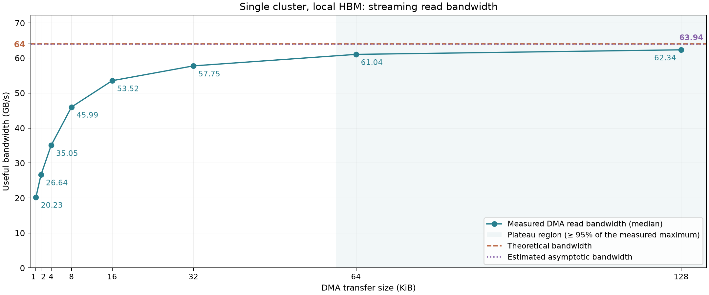
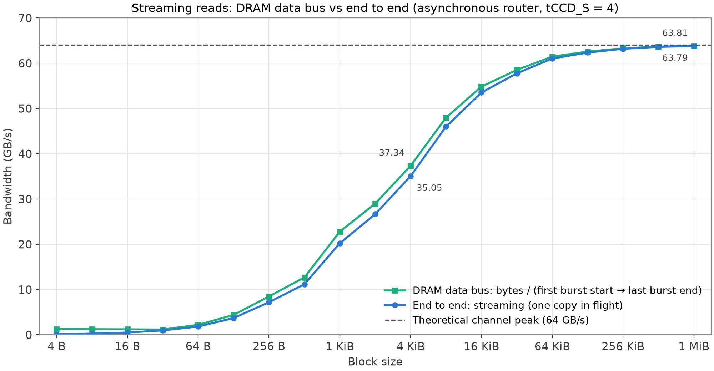
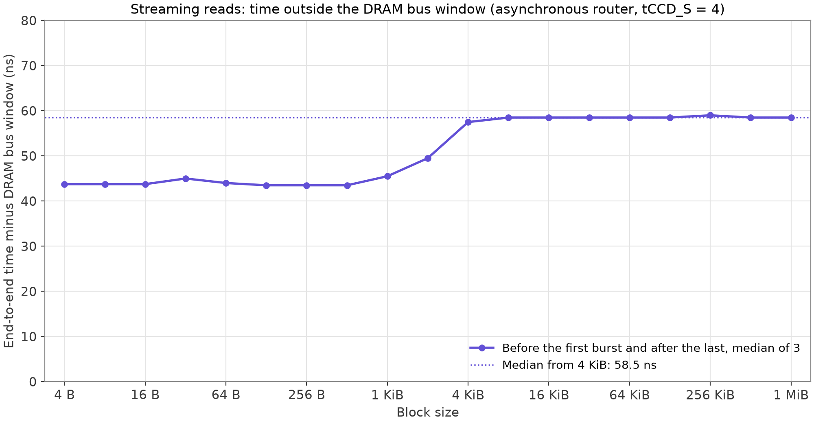
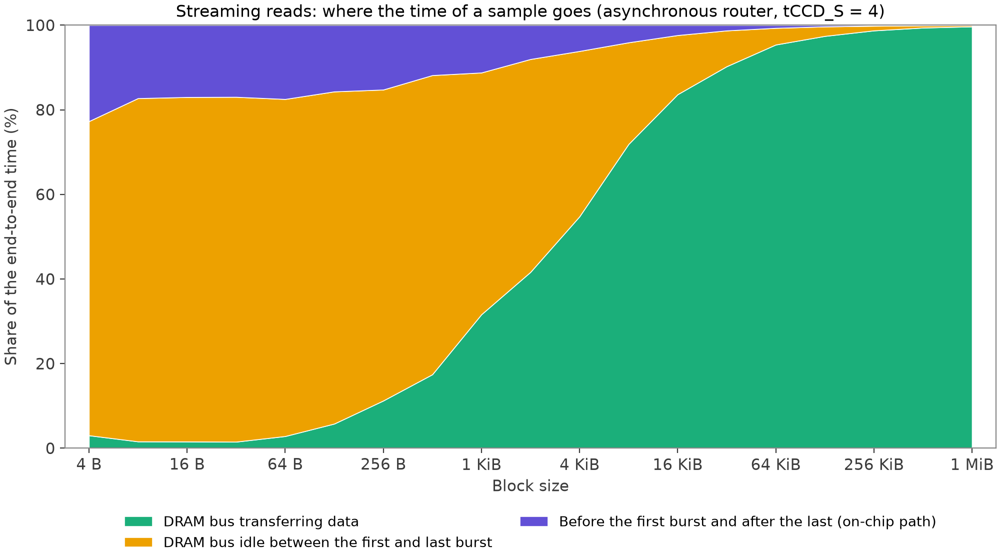
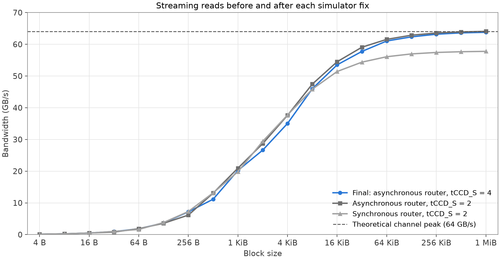

# Local HBM bandwidth: streaming reads

How fast can one cluster read **successive** HBM blocks as the copy size grows?
The DM core of cluster 0 reads its local HBM 0 into TCDM. Sizes double from
**4 B to 1 MiB**: 19 sizes, three samples each, eight copies per sample.

> **Simulator setup.** These results use the asynchronous wide-port arbiter and
> DRAMSys with `CCDS = 4`. The earlier synchronous arbiter capped large copies
> at ~57.9 GB/s through a modeling artifact (see
> [Wide-port arbiter model](#wide-port-arbiter-model)); the shared DRAMSys
> configuration's `CCDS = 2` lets bursts overlap on the data bus and exceed
> 64 GB/s (see the [pipelined guide](../app_dram_bandwidth_pipelined/README.md#why-ccds--2-exceeded-64-gbs)).

## Streaming vs warm

The [warm app](../app_dram_bandwidth_warm/README.md) uses the same firmware
with two differences, for a block of `N` bytes:

```text
Streaming:  no read warm-up; time A, A+N, A+2N, ..., A+7N
Warm:       read A once outside the timer, then time A, A, A, ..., A
```

Every streaming sample reads a distinct source window. Both apps reuse one TCDM
buffer and wait for each DMA copy before starting the next. No warm-up does not
mean closed rows: consecutive blocks can still hit open rows. With the
synchronous arbiter the two apps differed by about 0.1% at 64 KiB (56.080 vs
56.140 GB/s): for large blocks moving the bytes dominates. Since both warm-up
and addresses change, this comparison does not isolate row effects. The warm
sweep has not been re-measured with the asynchronous arbiter.

## What is timed

**Bandwidth = 8 × bytes per copy / elapsed time**, including DMA issue, waits
and clock reads. Setup, checks and printing are untimed.

Untimed DMA writes fill the source with a pattern and tag each block with its
address; a 100 µs wait lets them drain before measuring. After timing, the
buffer is checked against the last block. Up to 512 KiB, copies land at TCDM
offset `0x20000`; the 1 MiB copy uses the whole TCDM (the app has no persistent
`.l1` data and rejects it at runtime). Buffer layout: [bandwidth.h](../dram_common/bandwidth.h).

## Build and run

From the **SDK root**, after the [SoftHier setup](../../../README.md). No
`sh-data` is needed; the simulation takes about 15 minutes. The results below
use `CCDS = 4`: copy `dramsys_configs/` from the directory `DRAMSYS_PATH`
points to, set `"CCDS": 4` in `memspec/HBM4-emulation-4000.json`, and export
`DRAMSYS_PATH` pointing at the copy before `make sh-run`.

```bash
set -e
APP_DIR="$PWD/pulp/pulp/chips/softhier/common/sw/app_dram_bandwidth_streaming"
ANALYSIS_DIR="$PWD/pulp/pulp/chips/softhier/common/sw/app_dram_bandwidth_warm"
make sh-hw TOPOLOGY=2d_mesh
make sh-sw TOPOLOGY=2d_mesh app="$APP_DIR"
mkdir -p .local-artifacts/dram-bandwidth-streaming
RUN_DIR="$(mktemp -d "$PWD/.local-artifacts/dram-bandwidth-streaming/run.XXXXXX")"
cp sw_build/softhier.elf "$RUN_DIR/softhier.elf"
make sh-run TOPOLOGY=2d_mesh SH_TRACE_ARGS= RUN_ARGS="--work-dir=$RUN_DIR" \
    > "$RUN_DIR/simulation.log" 2>&1
python3 "$ANALYSIS_DIR/summarize.py" "$RUN_DIR/simulation.log" \
    --report "$RUN_DIR/report.md" > "$RUN_DIR/bandwidth.csv"
```

A valid run ends with `[dram-bandwidth] errors=0` and
`SoftHier DRAM bandwidth: OK`; the summary rejects incomplete runs. With
`DatabaseRecording: true` in DRAMSys you can also extract physical DRAM traffic:

```bash
python3 "$ANALYSIS_DIR/query_dram.py" "$RUN_DIR/simulation.log" "$RUN_DIR" \
    > "$RUN_DIR/dram.csv"
```

Each sweep with recording writes 2–4 GB of databases; delete the `.tdb` files
once `dram.csv` exists. The plateau criterion and the 64 GB/s reference are
described in the [warm guide](../app_dram_bandwidth_warm/README.md#reading-the-results).

## Results

All figures below share the same horizontal axis: the copy size, from 4 B to
1 MiB, doubling at each point. They come from one run on 2026-11-22
(asynchronous wide-port arbiter, DRAMSys with `CCDS = 4`). All 57 samples
passed the data check. The numbers are in [assets/bandwidth.csv](assets/bandwidth.csv)
and [assets/dram.csv](assets/dram.csv).

### How fast is one copy at a time?



**What it shows.** The bandwidth the cluster gets for each copy size, measured
by the core over eight copies, each awaited before the next starts. The dashed
line is the channel's theoretical peak, 64 GB/s. The grey area is the plateau:
from there on, every point is within 5% of the best one. The dotted curve is a
simple model, explained [below](#how-the-asymptote-is-calculated).

**What to take away.** Small copies are slow, because each one waits for its
whole round trip to the DRAM. Bandwidth flattens from 64 KiB, and at 1 MiB it
reaches **63.79 GB/s, 99.7% of the peak**. The light band around the curve is
the min–max of the three samples: below 4 KiB the samples differ by up to 23%,
because a sample lasts only a few hundred ns and a few ns of DRAM state change
it; from 16 KiB up they agree within 0.5%.

| Copy | `CCDS = 2` (2026-11-20) | `CCDS = 4` |
| ---: | ---: | ---: |
| 4 KiB | 37.621 GB/s | 35.046 GB/s |
| 16 KiB | 54.500 GB/s | 53.521 GB/s |
| 64 KiB | 61.558 GB/s | 61.042 GB/s |
| 256 KiB | 63.556 GB/s | 63.177 GB/s |
| 1 MiB | 64.076 GB/s | 63.786 GB/s |

With the old `CCDS = 2` the 1 MiB point went above the peak. Small copies
change the most: a 4 KiB copy takes 116.875 ns instead of 108.875 ns, because
`CCDS = 2` let bursts overlap and shortened every copy's data phase.

### How the asymptote is calculated

We fit the latency-bandwidth (alpha-beta/Hockney) model to the median time per copy:

$$
T(N)=\alpha+\beta N,\qquad B_{\infty}=1/\beta.
$$

In words: every copy pays a fixed cost `alpha`, then moves its `N` bytes at
bandwidth `1/beta`. `plot.py` fits the 64, 128 and 256 KiB points, giving
`alpha = 50.125 ns` and `1/beta = 63.938 GB/s` (64.06 ns per 4 KiB burst). The
512 KiB and 1 MiB points, left out of the fit, land within 0.1% of the
prediction (8242.375 and 16438.875 ns per copy measured, 8250.125 and
16450.125 ns predicted). `alpha` is an effective fixed cost, not a separate
measurement of DMA startup. With `CCDS = 2` the same fit gave 64.251 GB/s,
above the peak.

The model works from 4 KiB up. Smaller copies do better than it predicts
(1 KiB: 20.2 GB/s measured, 15.5 GB/s predicted) because their fixed cost is
smaller than `alpha`, as the next section shows.

### DRAM bandwidth vs what the cluster sees

The bandwidth above is measured by the core, so it includes everything: the
request travelling to the DRAM, the DRAM itself, and the data coming back. To
see the DRAM on its own we also read the DRAMSys records, which tell exactly
when each 32 B burst used the DRAM data bus.



**What it shows.** Two bandwidths for the same samples:

- **Blue, end to end:** bytes copied / time measured by the core. This is what
  software gets.
- **Green, DRAM data bus:** bytes the DRAM transferred / time from the first
  burst to the last one on the data bus. This is how hard the DRAM itself is
  working. (Below 32 B the DRAM still reads a whole 32 B burst per copy, so the
  green curve counts more bytes than the copy.)

**What to take away.** The two curves stay close and meet at the top: at 1 MiB
the DRAM bus carries 63.81 GB/s and the cluster gets 63.79 GB/s. Unlike the
[pipelined sweep](../app_dram_bandwidth_pipelined/README.md#dram-bandwidth-vs-what-the-cluster-sees),
here even the DRAM is far from its limit for mid-size copies (37.3 GB/s at
4 KiB): with one copy at a time, the DRAM spends part of its window waiting.



**What it shows.** For each sample, the core's measured time minus the DRAM's
busy window: the time before the first burst (the first request travelling to
the DRAM) and after the last one (the last data travelling back).

**What to take away.** From 4 KiB to 1 MiB this extra time is **about 58.5 ns,
always the same**, whatever the size. It is a fixed latency, not a lower
bandwidth: 6% of a 4 KiB sample, 0.04% of a 1 MiB one. Below 4 KiB it is
shorter, about 43.5 ns, and grows by about 2 ns per 512 B up to 4 KiB (the
largest burst the iDMA sends). We have not traced why yet; it looks like the
last burst's data crossing the interconnect after the DRAM is done.



**What it shows.** Each sample's time split into three parts, as a share of
the total: green, the DRAM bus moving data; yellow, the DRAM bus sitting idle
between the first and the last burst; purple, the time outside the DRAM window
(first request going out, last data coming back).

**What to take away.** The big yellow area is the cost of waiting for each
copy: between two copies the DRAM sits idle for about 50 ns, the round trip of
the next request. That adds up to 340–380 ns per sample from 8 KiB up. At
4 KiB the DRAM is busy only 55% of the time; up to 512 B, less than 18%. The
yellow shrinks only because large copies make the gaps negligible. The
[pipelined sweep](../app_dram_bandwidth_pipelined/README.md) removes it by
keeping eight copies queued.

## Wide-port arbiter model

Each cluster's iDMA reaches the NoC through `wide_arbiter_<cluster>`
([softhier_system_base.py](../../../softhier_system_base.py)), a router with
`bandwidth=noc_link_width` (512 B/cycle) that models the cluster's wide AXI port.

**Synchronous router (previous default): artifact.** It charged a read burst's
data **when the request passed** (`BandwidthLimiter::apply_bandwidth` in
`core/models/interco/router/router.cpp`) and stored the wait in the request
latency, without delaying the request. The iDMA issues one 4 KiB burst per
cycle, each counted as 8 cycles, so burst *k* got **7·k cycles** of latency.
The DRAM then served the bursts at its own pace, and the iDMA AXI backend
(`pulp/idma/be/idma_be_axi.cpp`) **added** that latency to the real response:
the queueing was counted twice. Each 4 KiB burst cost 63.75 ns of DRAM time plus
7 ns, so 4096 / 70.75 ≈ 57.9 GB/s. In hardware the R channel carries the data
while it comes back, overlapping DRAM time.

**Asynchronous router (`synchronous=False`, current).** Requests are queued and
leave the port spaced by its bandwidth (one 4 KiB burst every 8 cycles);
responses pass straight back with no added latency. Against a DRAM that serves
one burst every ~64 ns the spacing costs nothing, while a fast target would
still be limited to 512 B/cycle. It throttles the request side rather than the
R channel, so it is not a beat-accurate AXI model, but the throughput is right
and nothing is counted twice. The router adds one cycle per request: it shows
on single-burst copies (4 KiB: 108.875 instead of 108.625 ns per copy in the
median) and on small write/readback copies, where the iDMA sends write chunks
of 512 B one at a time.

Streaming sweep, same firmware, both routers, both with the shared `CCDS = 2`
DRAMSys configuration (copies below 4 KiB vary by a few ns per sample with DRAM
state in both runs):

| Copy | Synchronous router | Asynchronous router |
| ---: | ---: | ---: |
| 4 KiB | 37.708 GB/s | 37.621 GB/s |
| 16 KiB | 51.421 GB/s | 54.500 GB/s |
| 64 KiB | 56.080 GB/s | 61.558 GB/s |
| 256 KiB | 57.429 GB/s | 63.556 GB/s |
| 1 MiB | 57.777 GB/s | 64.076 GB/s |

The trace shows the difference with
`--trace=/system/cluster_0/idma/axi_read --trace-level=trace`: the lines
`Handling end of read request (... latency N)` grow by 7 per burst with the
synchronous router and stay at 0 with the asynchronous one.



**What it shows.** The same sweep in the three simulator configurations we
went through: the synchronous router with `CCDS = 2` (light grey, the
original), the asynchronous router with `CCDS = 2` (dark grey), and the final
asynchronous router with `CCDS = 4` (blue).

**What to take away.** The router fix is the big one: the synchronous router
flattens at about 57.8 GB/s, 9.4% below the final curve at 1 MiB, because it
adds 7 ns to every 4 KiB burst. The `CCDS` fix is small but matters at the
top: with `CCDS = 2` the curve ends slightly above the 64 GB/s peak (0.5–3.2%
faster from 8 KiB up, 7.4–7.7% at 2–4 KiB, because overlapping bursts shorten
each copy). Below 1 KiB the three curves cross each other at random: a sample
lasts only about 270 ns there, so a few ns of DRAM state (open rows, refresh
timing) decide the order.

## Regenerate the figures

```bash
APP_DIR="$PWD/pulp/pulp/chips/softhier/common/sw/app_dram_bandwidth_streaming"
pulp/.venv/bin/python "$APP_DIR/plot.py"
```

`plot.py` reads the CSVs in `assets/` and redraws, one chart per image,
`bandwidth.png`, `dram_vs_end_to_end.png`, `fixed_cost.png` and
`time_breakdown.png` (from `dram.csv`), and `simulator_fixes.png` (from
`bandwidth_ccds2.csv` and `bandwidth_sync_router_ccds2.csv`, the 2026-11-20 and
earlier runs). For a new run, `plot.py "$RUN_DIR"` reads `bandwidth.csv` and
`dram.csv` there and writes the figures next to them (`--output-dir` changes
this); figures whose CSVs are missing are skipped. The fit needs the
64/128/256 KiB points. All DRAM sweep figures share
[dram_common/plot_sweep.py](../dram_common/plot_sweep.py), which fixes the
4 B–1 MiB axis.
