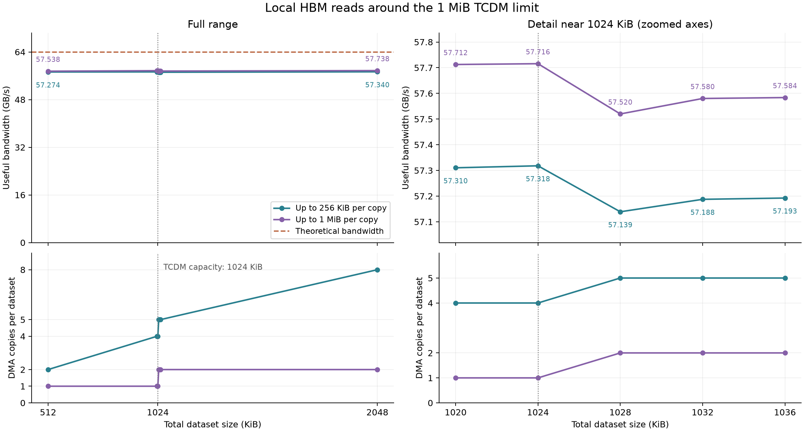

# Local HBM reads around the TCDM capacity

This benchmark asks: **does bandwidth dip just above the cluster's 1 MiB
TCDM capacity?** Cluster 0 reads local HBM 0 with the same hardware and DRAM
timings as the [streaming benchmark](../app_dram_bandwidth_streaming/README.md).

## Dataset sizes and DMA copies

We test exactly **512, 1020, 1024, 1028, 1032, 1036 and 2048 KiB**, with
maximum DMA copies of **256 KiB and 1 MiB**. Three samples per combination
give **42 measurements**. One sample reads the complete dataset once.

A copy must fit in its TCDM buffer. Larger datasets are split into consecutive
copies, waiting before reusing and overwriting the same buffer. The final
copy transfers only the remaining bytes:

```text
1024 KiB dataset, 1 MiB DMA limit:  [1024 KiB]
1028 KiB dataset, 1 MiB DMA limit:  [1024 KiB] + [4 KiB]
1032 KiB dataset, 1 MiB DMA limit:  [1024 KiB] + [8 KiB]
1036 KiB dataset, 1 MiB DMA limit:  [1024 KiB] + [12 KiB]
2048 KiB dataset, 1 MiB DMA limit:  [1024 KiB] + [1024 KiB]
```

The small final copy adds another DMA issue/wait. Unlike two full-size copies,
it carries few bytes over which to spread that cost. The 256 KiB comparison
also gains an extra copy above 1024 KiB: four full tiles become five copies.
We measure the resulting change rather than assume a drop in advance.

Both limits read the same prefix of one initialized **2 MiB** HBM region.
Samples and sizes reuse it, unlike the original streaming sweep's distinct
source windows. There is no read warm-up and rows are not forced closed.
We alternate the two limits' order across samples to reduce order bias.

## What is timed?

**Bandwidth = total dataset bytes / elapsed time.** The interval includes
all DMA issue/wait, loop and clock-read overhead. Setup, data checks and
printing are untimed. The DMA can have internal requests in flight within
a copy, but software waits before starting the next copy.

For dataset size `N` and DMA limit `C`, there are `ceil(N / C)` copies.
The last contains `N - (ceil(N / C) - 1) * C` bytes; we never pad it to `C`.
The log and CSV record both counts and the exact final-copy size.

This is a transfer-only benchmark: overwritten data is discarded. Processing
or retaining every tile, output traffic and double buffering are not modeled.
We change software copy sizes, keeping the hardware TCDM at 1 MiB.

## Saved results



Median useful bandwidth from three samples per case:

| Dataset (KiB) | Up to 256 KiB per copy | Up to 1 MiB per copy | Copies: 256 KiB / 1 MiB |
| ---: | ---: | ---: | ---: |
| 512 | 57.274 GB/s | 57.538 GB/s | 2 / 1 |
| 1020 | 57.310 GB/s | 57.712 GB/s | 4 / 1 |
| 1024 | 57.318 GB/s | 57.716 GB/s | 4 / 1 |
| 1028 | 57.139 GB/s | 57.520 GB/s | 5 / 2 |
| 1032 | 57.188 GB/s | 57.580 GB/s | 5 / 2 |
| 1036 | 57.193 GB/s | 57.584 GB/s | 5 / 2 |
| 2048 | 57.340 GB/s | 57.738 GB/s | 8 / 2 |

**A small dip appears immediately above 1024 KiB.** With the 1 MiB DMA limit,
bandwidth falls from **57.716 to 57.520 GB/s** at 1028 KiB, a **0.34%** drop.
The second copy moves only 4 KiB. Bandwidth recovers as that tail grows, reaching
**57.738 GB/s** at 2048 KiB with two full 1 MiB copies. The 256 KiB limit also
shows a dip when a fifth copy is needed. This is the measured end-to-end cost
of segmentation for this access pattern, not a change to physical HBM bandwidth.

All **42 samples** passed the final-tile data check. The DRAM audit verified
the exact dataset byte count, unique aligned 32 B reads and complete address
range for every sample, including the small tails. Setup write strobes ended
**100149.250 ns** before the first measurement. Full aggregate values and final
copy sizes are in [assets/bandwidth.csv](assets/bandwidth.csv).

## Data checks and buffer safety

Untimed DMA writes initialize HBM at offset 32 MiB, with an absolute-address
marker on each 64 KiB page. A 100 µs delay lets setup writes drain; check their
completion in the DRAM records.

The 256 KiB buffer starts at TCDM offset `0x20000`; the 1 MiB buffer starts
at zero and can use all TCDM. Only the cluster 0 DM core is active, staging
data is dead after setup, and no barriers are used. Stacks/code live elsewhere;
the app rejects persistent linker `.l1` data.

Every word of the final tile is checked after timing, including a partial
64 KiB page. Earlier tiles have been overwritten: the DRAM audit verifies their
complete address range, unique read bursts and exact byte count. The parser
rejects partial runs, errors, invalid tail sizes and overlapping time windows.

## Build and run

From the **SDK root**, after the [SoftHier environment setup](../../../README.md):

```bash
set -e
APP_DIR="$PWD/pulp/pulp/chips/softhier/common/sw/app_dram_bandwidth_tiled"
make sh-hw TOPOLOGY=2d_mesh
make sh-sw TOPOLOGY=2d_mesh app="$APP_DIR"
mkdir -p .local-artifacts/dram-bandwidth-tiled
RUN_DIR="$(mktemp -d "$PWD/.local-artifacts/dram-bandwidth-tiled/run.XXXXXX")"
cp sw_build/softhier.elf "$RUN_DIR/softhier.elf"
make sh-run TOPOLOGY=2d_mesh SH_TRACE_ARGS= RUN_ARGS="--work-dir=$RUN_DIR" \
    > "$RUN_DIR/simulation.log" 2>&1
python3 "$APP_DIR/summarize.py" "$RUN_DIR/simulation.log" > "$RUN_DIR/bandwidth.csv"
python3 "$APP_DIR/query_dram.py" "$RUN_DIR/simulation.log" "$RUN_DIR" > "$RUN_DIR/dram.csv"
```

Hardware only needs rebuilding after model changes. The app prepares its own
data; `sh-data` is unnecessary. A successful log contains
`[dram-tiled] errors=0` and `SoftHier tiled DRAM bandwidth: OK`.

To plot a completed run with the existing Matplotlib environment:

```bash
pulp/.venv/bin/python "$APP_DIR/plot.py" "$RUN_DIR/bandwidth.csv"
```

The script saves PNG and SVG in `assets/`. The left column shows the full
512–2048 KiB range; the right zooms into **1020–1036 KiB** so nearby values
remain readable. The top row shows bandwidth and the bottom row shows
**DMA copies per dataset**. All axes are linear. A vertical marker identifies
the 1024 KiB TCDM capacity; the theoretical bandwidth reference is 64 GB/s.
