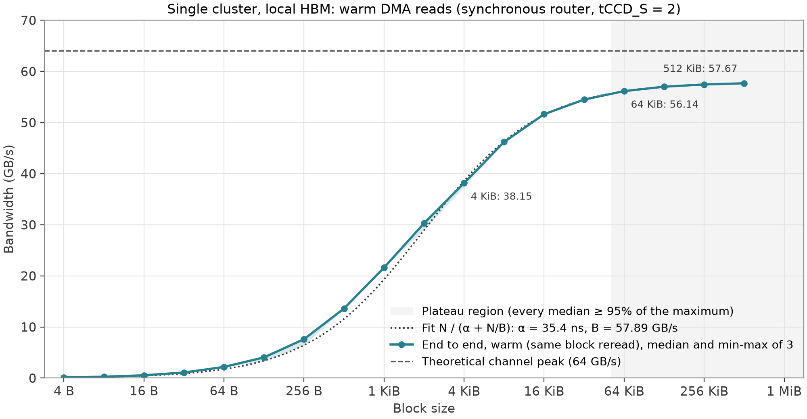

# Local HBM bandwidth: warm reads

How fast can one cluster **reread the same** HBM block as its size grows? The
DM core of cluster 0 reads local HBM 0 into TCDM. Sizes double from **4 B to
512 KiB**: 18 sizes, three samples each, eight copies per sample.

> **Not re-measured.** These results come from the synchronous wide-port
> arbiter, whose modeling artifact caps copies above 4 KiB at ~57.9 GB/s. With
> the asynchronous arbiter now in use and DRAMSys `CCDS = 4`, the streaming sweep
> reaches 63.79 GB/s at 1 MiB; re-run this sweep before comparing. See the [explanation](../app_dram_bandwidth_streaming/README.md#wide-port-arbiter-model).

## Warm vs streaming

The [streaming app](../app_dram_bandwidth_streaming/README.md) uses the same
firmware with two differences, for a block of `N` bytes:

```text
Warm:       read A once outside the timer, then time A, A, A, ..., A
Streaming:  no read warm-up; time A, A+N, A+2N, ..., A+7N
```

The warm-up runs before every sample and may leave useful DRAM rows open, but a
large block spans many rows, so the start may need reopening. At 64 KiB the two
apps differ by about 0.1% (56.140 vs 56.080 GB/s). Use warm reads for repeated
data and streaming for successive data.

## What is timed

**Bandwidth = 8 × bytes per copy / elapsed time**, including DMA issue, waits
and clock reads. Setup, warm-up, checks and printing are untimed. The source is
the last 512 KiB of HBM 0; copies land at TCDM offset `0x20000`. The CSV
reports median, minimum and maximum sample bandwidth.

## Build and run

From the **SDK root**, after the [SoftHier setup](../../../README.md). No
`sh-data` is needed.

```bash
set -e
APP_DIR="$PWD/pulp/pulp/chips/softhier/common/sw/app_dram_bandwidth_warm"
make sh-hw TOPOLOGY=2d_mesh
make sh-sw TOPOLOGY=2d_mesh app="$APP_DIR"
mkdir -p .local-artifacts/dram-bandwidth
RUN_DIR="$(mktemp -d "$PWD/.local-artifacts/dram-bandwidth/run.XXXXXX")"
cp sw_build/softhier.elf "$RUN_DIR/softhier.elf"
make sh-run TOPOLOGY=2d_mesh SH_TRACE_ARGS= RUN_ARGS="--work-dir=$RUN_DIR" \
    > "$RUN_DIR/simulation.log" 2>&1
python3 "$APP_DIR/summarize.py" "$RUN_DIR/simulation.log" \
    --report "$RUN_DIR/report.md" > "$RUN_DIR/bandwidth.csv"
```

A valid run ends with `[dram-bandwidth] errors=0` and
`SoftHier DRAM bandwidth: OK`. With `DatabaseRecording: true` in DRAMSys:

```bash
python3 "$APP_DIR/query_dram.py" "$RUN_DIR/simulation.log" "$RUN_DIR" \
    > "$RUN_DIR/dram.csv"
```

## Reading the results

The report finds a **plateau** when the last three size medians differ by at
most 3%. Its onset is the earliest size, with at least two larger sizes after
it, from which every median stays within 5% of the maximum.

The reference is **64 GB/s**, the nominal bus bandwidth of one HBM channel;
utilization is `100 × measured / 64` (`--peak-gbps` changes it). The emulation
does not enforce this peak exactly.

## Results



The figure shows 1–128 KiB; all 18 sizes are in
[assets/bandwidth.csv](assets/bandwidth.csv). The dotted line is the large-copy
limit fitted with `T(N) = alpha + beta·N` on 64/128/256 KiB: `alpha = 35.375 ns`,
`1/beta = 57.894 GB/s`, matching the excluded 512 KiB point. This limit is the
synchronous wide-port artifact (see the note above); the fit is explained in the
[streaming guide](../app_dram_bandwidth_streaming/README.md#how-the-asymptote-is-calculated).

To regenerate the figure:

```bash
APP_DIR="$PWD/pulp/pulp/chips/softhier/common/sw/app_dram_bandwidth_warm"
pulp/.venv/bin/python "$APP_DIR/plot.py" "$APP_DIR/assets/bandwidth.csv"
```

Use `"$RUN_DIR/bandwidth.csv"` for a new run, or `--output path.png` to save
elsewhere.
